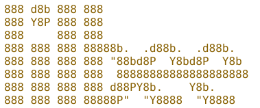
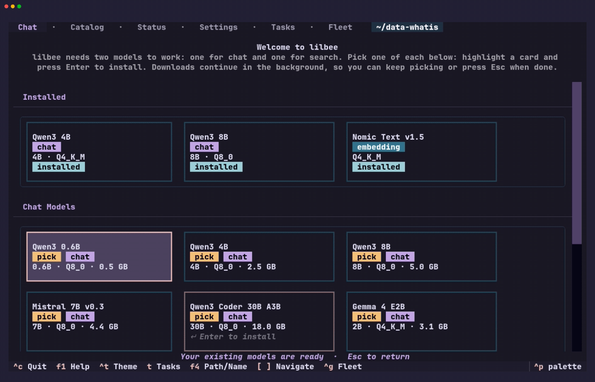
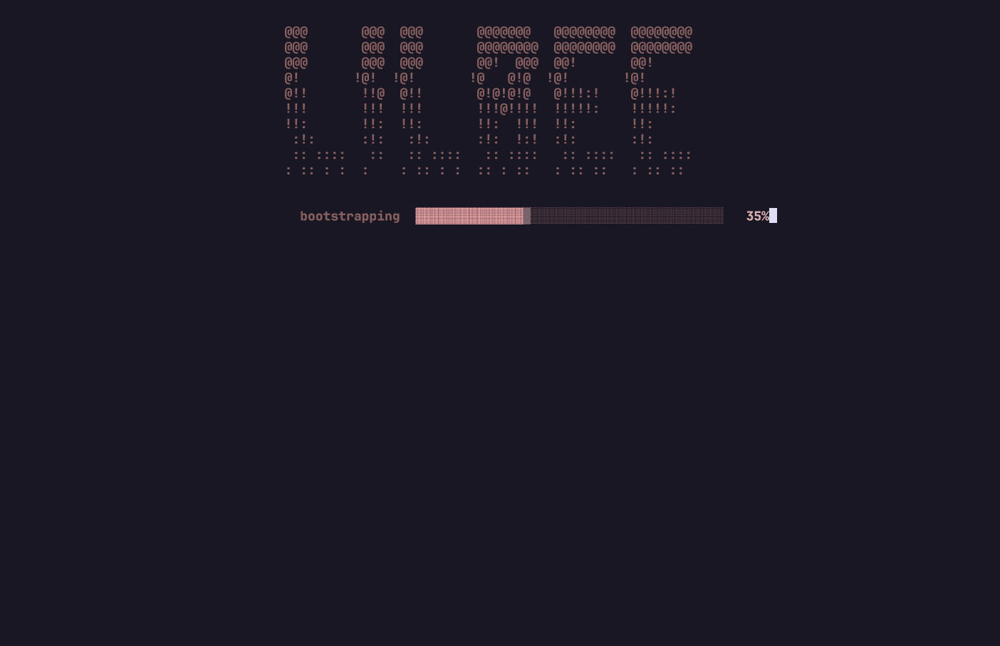
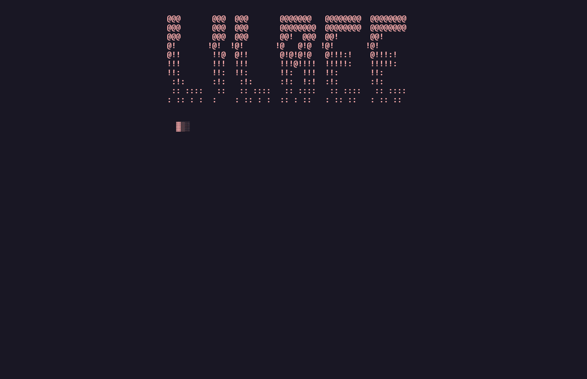

<p align="center">
  <a href="https://lilbee.sh/">
    <picture>
      <source media="(prefers-color-scheme: dark)" srcset="https://raw.githubusercontent.com/tobocop2/lilbee/main/docs/lilbee-logo-dark.svg">
      
    </picture>
  </a>
</p>

<p align="center"><strong>The whole local AI stack in one executable: it runs and manages the models, and searches everything you own with them.</strong></p>

<p align="center"><a href="https://lilbee.sh/">Project site</a> &nbsp;·&nbsp; <a href="https://lilbee.sh/tutorial">Tutorial reels</a> &nbsp;·&nbsp; <a href="https://pypi.org/project/lilbee/">PyPI</a> &nbsp;·&nbsp; <a href="https://obsidian.lilbee.sh/">Obsidian plugin</a> &nbsp;·&nbsp; <a href="https://lilbee.sh/api/">REST API</a> &nbsp;·&nbsp; <a href="https://web.libera.chat/#lilbee">Chat (#lilbee)</a></p>

<p align="center">
  <a href="https://github.com/tobocop2/lilbee/releases/latest"></a>
  <a href="https://pypi.org/project/lilbee/"></a>
  <a href="https://www.python.org/downloads/"></a>
  <a href="LICENSE"></a>
  &nbsp;&nbsp;
  <a href="https://github.com/tobocop2/lilbee/actions/workflows/ci.yml"></a>
  <a href="https://lilbee.sh/coverage/"></a>
  <a href="https://mypy-lang.org/"></a>
  <a href="https://github.com/astral-sh/ruff"></a>
</p>

<p align="center">
  
  <a href="https://github.com/tobocop2/homebrew-lilbee"></a>
  <a href="https://aur.archlinux.org/packages/lilbee"></a>
  <a href="https://github.com/tobocop2/lilbee#install"></a>
  <a href="https://github.com/tobocop2/scoop-lilbee"></a>
  <a href="https://github.com/tobocop2/lilbee/pkgs/container/lilbee"></a>
  <a href="https://github.com/tobocop2/flatpak-lilbee"></a>
  <a href="https://github.com/tobocop2/lilbee/releases/latest"></a>
  <a href="https://pypi.org/project/lilbee/"></a>
  <a href="https://www.npmjs.com/package/lilbee"></a>
</p>

<p align="center">
  <a href="https://github.com/tobocop2/lilbee/releases"></a>
  <a href="https://glama.ai/mcp/servers/tobocop2/lilbee"></a>
  <a href="https://mcpservers.org/servers/tobocop2/lilbee"></a>
</p>

<p align="center">
  <a href="https://community.obsidian.md/plugins/lilbee"></a>
  <a href="https://web.libera.chat/#lilbee"></a>
</p>

lilbee runs your models and puts them to work as a search engine you can talk to. It searches your files, notes, code and saved web pages, and every answer cites its source, down to the line or page. It also crawls websites into your library, [launches your coding agents on local models](#launch-your-coding-agent-on-local-models), and gives any [MCP-aware agent](#a-reference-for-ai-agents) cited answers. Ask in plain English.

It is private. Your files, the index and your questions stay on your machine. No telemetry, no account. lilbee contacts a cloud provider only when you set its API key.

**Prefer a GUI?** The [Obsidian plugin](https://obsidian.lilbee.sh/) puts lilbee's model manager and search inside your vault, with no terminal needed.



> **Tutorial reel:** every demo on this page and more, with long-form captions, at [**lilbee.sh/tutorial**](https://lilbee.sh/tutorial).

> **Beta software.** lilbee is in **active beta**. Every PyPI release is a pre-release, so `pip` needs `--pre` and `uv` needs `--prerelease=allow`. Commands and on-disk formats can change between betas. Bug reports are very welcome; that's the whole point of the beta. Latest pre-release: [lilbee on PyPI](https://pypi.org/project/lilbee/).

## Why lilbee

A small local model is fun, but limited on its own. Give it properly processed documents and a search engine over them, and it becomes genuinely powerful. Without those, it never gets past novelty.

lilbee is built for consumer hardware and for people who don't want to babysit infrastructure. It isn't another model server you point an app at; it's a local search engine with the model runner built in.

- **Install one file. Talk to your stuff.** Most ways to chat with your documents locally mean Docker, a separate model server, a database service and a browser tab. lilbee needs none of them. Point it at a folder, and local AI is useful from the first question.
- **A search engine with proof.** On MS MARCO (8.8M passages, 6,980 real queries), lilbee's general-purpose pipeline scores MRR@10 0.365. That is above ColBERT, a system trained only for that test. Few local tools publish a retrieval score for their own pipeline at all. [See the benchmark](docs/benchmarks/retrieval-msmarco.md).
- **Native speed underneath.** Models run in [llama.cpp] (C and C++). The index, the document reader, the crawler and the code parser are Rust ([LanceDB], [Xberg], [crawlberg], [tree-sitter]). [Nuitka] compiles lilbee itself into one native binary.
- **Runs on what you have.** Native executables for macOS, Linux and Windows, with Metal, Vulkan, CUDA and ROCm builds, and a build for CPUs from before 2013. One command on Homebrew, Scoop, AUR, Nix, Flatpak, Snap, npm, PyPI or Docker. [Smaller than LM Studio everywhere, and than Ollama on Windows and Linux](#one-file-the-whole-stack), and it carries the whole stack.
- **Every GPU does the work.** Chat, embedding, vision and rerank are placed together across all your cards, and indexing runs one embedder on each card. A model too big for one card [runs across several](#run-a-model-bigger-than-one-card).
- **Answers you can check.** Click a citation to open the source at the line or page. When the answer isn't in your library, lilbee says so. The [wiki](#wiki) checks every cited excerpt against the source before a page publishes.
- **Your agents, on local models.** `lilbee launch` starts a model and your coding agent, with lilbee's search connected over MCP. [Watch four agents share one model](#agents).
- **Private.** Your files, the index, the embeddings, your questions and the answers stay on your machine.

The same engine works two ways:

- **An [Encarta 99](https://en.wikipedia.org/wiki/Encarta) over your own files.** Build a library from your documents and saved web pages, then read it and ask it questions in the terminal.
- **A reference layer for code.** Point it at your project, dependencies and API docs. Your coding agent answers from what is actually there, with file:line citations, instead of guessing function names.

> **The long-term goal:** make local AI genuinely useful on hardware you already own, with no token budgets, no provider to depend on, and nothing about your files leaving your machine; the cloud's there only when you want it.

### And more

- **Know before you download.** lilbee checks a model's fit against your GPUs, and [flags a model the engine can't run](#see-when-a-model-wont-load-before-you-download-it).
- **Chunks that stand on their own.** [Prose and code are split differently](#documents-code-and-scanned-images), which is where most of the retrieval quality lives.
- **Already on Ollama or LM Studio? Keep them.** lilbee's own manager covers the same [architectures](#supported-models) they run, and [their models show up in lilbee's pickers](#already-running-ollama-or-lm-studio-keep-them).
- **Per-project libraries.** One library for everything, or [one per project](docs/usage.md#per-project-libraries).
- **Tunable.** Sane defaults, and 50+ [settings](docs/settings.md) from the TUI, MCP, HTTP, env vars or `config.toml`.
- **The demos are real.** Every GIF and reel is recorded live on real hardware, nothing staged. 100% test coverage, full typing, CI on macOS, Linux and Windows.

## One file. The whole stack.

No model server, no [vector database](#built-on), no container to stand up. One executable holds all of it:

| | |
|---|---|
| **Search engine** | hybrid search, reranking and cited answers over everything you index |
| **Model runner** | browse Hugging Face, pull a model, run it on Metal, Vulkan, CUDA or ROCm |
| **Multi-GPU fleet** | chat, embedding, vision and rerank placed across every card, behind a load-balancing router |
| **Web crawler** | save a whole docs site to your library and search it offline |
| **Document reader** | 120+ file types, OCR for scans, code split by function across 300+ languages |
| **Wiki writer** | cited, verified pages about the concepts in your library |
| **Agent server** | MCP for coding agents, plus an Anthropic- and OpenAI-style API |
| **HTTP API, TUI, CLI** | and a Python library, all from the same file |

It loads on demand. Close it and it's gone; nothing stays running.

And it is still small. Even lilbee's CUDA build stays under Ollama's, and it's the whole stack, not just a model runner.

| | macOS | Windows | Linux | What you get |
|---|---|---|---|---|
| **[lilbee](https://github.com/tobocop2/lilbee/releases)** (Metal / Vulkan) | **290 MB** | **304 MB** | **420 MB** | the whole stack above |
| **[lilbee](https://github.com/tobocop2/lilbee/releases)** (CUDA, for NVIDIA) | n/a | 635 MB | 1.22 GB | the whole stack, with the CUDA runtime |
| **[lilbee](https://github.com/tobocop2/lilbee/releases)** (ROCm, for AMD) | n/a | n/a | 817 MB | the whole stack, with the ROCm runtime |
| [Ollama](https://github.com/ollama/ollama/releases) | 230 MB | 1.86 GB (CUDA bundled) | 1.55 GB (CUDA bundled) | a model runner, fetches its runtimes separately |
| [LM Studio](https://lmstudio.ai/download) | 573 MB | 626 MB | 1.03 GB | a desktop app (Electron) |
| [vLLM](https://docs.vllm.ai/en/stable/getting_started/installation/gpu/) | n/a | n/a | multi-GB | a Python + CUDA serving engine |

<sub>Download sizes in decimal MB and GB, models excluded, from each project's own release files. Measured 2026-11-11 from lilbee v0.6.90b692, Ollama v0.40.16 and LM Studio 0.4.28-2. The files are lilbee's `macos-arm64`, `windows-x86_64.exe` and `linux-x86_64` executables (CUDA: `cu125`), Ollama's `Ollama.dmg`, `OllamaSetup.exe` and `ollama-linux-amd64.tar.zst`, and LM Studio's arm64 `.dmg`, x64 `.exe` and x64 `.AppImage`.</sub>

## Install

```sh
curl -fsSL https://lilbee.sh/install.sh | sh     # macOS / Linux
irm https://lilbee.sh/install.ps1 | iex          # Windows
```

Or use your package manager:

| | |
|---|---|
| **Homebrew** | `brew tap tobocop2/lilbee && brew install lilbee` |
| **Scoop** | `scoop install git; scoop bucket add lilbee https://github.com/tobocop2/scoop-lilbee; scoop install lilbee` |
| **AUR** | `paru -S lilbee` |
| **Nix** | `nix run github:tobocop2/lilbee` |
| **npm** | `npm install -g lilbee` |
| **Docker** | `docker run --rm -v lilbee-data:/home/lilbee/data ghcr.io/tobocop2/lilbee:latest --help` |
| **Flatpak, Snap, binary** | see the [install guide](docs/install.md#every-channel) |

Then start it:

```bash
lilbee self-check    # ~90 MB download; one inference and one embedding; prints "SELF-CHECK PASSED"
lilbee               # the terminal app; pick your models on first run
```

Pick a model that fits your machine from the catalog, and you're chatting. The [usage guide](docs/usage.md) covers the rest: TUI screens, slash commands, CLI, HTTP server, MCP, env vars and `config.toml`.

The bundled builds use your GPU through Vulkan or Metal. NVIDIA and AMD cards get faster [CUDA](docs/install.md#nvidia-cuda) and [ROCm](docs/install.md#amd-rocm) builds. The [install guide](docs/install.md) also covers [older CPUs](docs/install.md#older-cpus-pre-avx2), [pip and uv](docs/install.md#pip-and-uv), and [hardware requirements](docs/install.md#hardware-requirements).

## How lilbee compares

lilbee sits between the desktop runners that get one model chatting ([Ollama](https://ollama.com), [LM Studio](https://lmstudio.ai)) and [vLLM](https://github.com/vllm-project/vllm), the server that pushes one model to many users. It places chat, embedding, vision and reranking together across the GPUs in the machine, and spreads indexing across every card.

The closest project is [AnythingLLM](https://github.com/Mintplex-Labs/anything-llm), an all-in-one app for chat with your documents. It ships as an Electron desktop app or a Docker server; lilbee is one headless executable. AnythingLLM sends telemetry unless you turn it off; lilbee sends none.

<details>
<summary><b>Full comparison: lilbee vs AnythingLLM, LM Studio, Ollama and vLLM</b></summary>

| | lilbee | [AnythingLLM](https://github.com/Mintplex-Labs/anything-llm) | [LM Studio](https://lmstudio.ai/) | [Ollama](https://ollama.com/) | [vLLM](https://github.com/vllm-project/vllm) |
|---|---|---|---|---|---|
| **Primary focus** | local search, chat, and serving across your GPUs | all-in-one app for chat with your documents, and agents | desktop app to run and chat with models | local model runner with a growing ecosystem | high-throughput GPU serving |
| How it ships | one headless executable | [Electron desktop app or Docker server](https://github.com/Mintplex-Labs/anything-llm#readme) | desktop app | app or archive with its runtimes | Python package |
| Runs local models | ✓ | ✓ [built-in engine (Lemonade, llama.cpp)](https://github.com/Mintplex-Labs/anything-llm/blob/master/docker/HOW_TO_USE_DOCKER.md#built-in-llm-engine-optional) | ✓ | ✓ | ✓ |
| Search your own files, with citations | ✓ [full RAG pipeline](docs/architecture.md#search), inline per-line citations | ✓ workspace RAG with source citations | per-session doc attachment ([RAG, document-level citation](https://lmstudio.ai/docs/app/basics/rag)) | — | — |
| Published retrieval benchmark | ✓ [MS MARCO](docs/benchmarks/retrieval-msmarco.md) | — | — | — | — |
| Chat, embedding, vision, rerank as one managed fleet | ✓ [all four, coordinated](docs/architecture.md#models-and-gpus) | chat, embedding and a [native reranker](https://github.com/Mintplex-Labs/anything-llm/tree/master/server/utils/EmbeddingRerankers/native), set up one by one | chat, embed, vision (no rerank), [loaded individually](https://lmstudio.ai/docs/developer/core/server) | chat, embed, vision (no rerank), [several loaded per GPU](https://docs.ollama.com/faq) | each supported, but [one model per server](https://docs.vllm.ai/en/stable/serving/openai_compatible_server/) |
| Multi-GPU model placement | ✓ [VRAM-aware tensor-split](docs/architecture.md#models-and-gpus) | not documented | ✓ GPU selection + [tensor parallelism (CUDA)](https://lmstudio.ai/changelog/lmstudio-v0.4.15) | ✓ [auto multi-GPU offload](https://docs.ollama.com/faq) | ✓ [tensor + pipeline parallel](https://docs.vllm.ai/en/latest/serving/parallelism_scaling.html) |
| Indexing spread across every GPU | ✓ [an embedding and OCR replica per GPU, load-balanced](docs/architecture.md#models-and-gpus) | — | — | — | — |
| Web crawler built in | ✓ [whole sites, concurrent, saved as markdown](#offline-copies-of-websites) | [depth 1 to 5, 20 pages by default, saved as plain text](https://github.com/Mintplex-Labs/anything-llm/blob/master/collector/utils/extensions/WebsiteDepth/index.js) | — | — | — |
| Long-term memory (opt-in) | ✓ [opt-in](docs/usage.md#memory) | ✓ | — | — | — |
| Interfaces | [TUI, CLI, MCP server, REST, Python](docs/architecture.md#interfaces), Obsidian GUI | desktop GUI, web UI, REST API, chat widget, MCP client | [desktop GUI, lms CLI, Python + TS SDKs, REST API, MCP client](https://lmstudio.ai/docs) | [desktop GUI, CLI, REST API, Python/JS libs](https://docs.ollama.com/) | [API server](https://docs.vllm.ai/en/stable/serving/openai_compatible_server/) |
| Use your existing Ollama / LM Studio / cloud as a backend | ✓ [how](#already-running-ollama-or-lm-studio-keep-them) | ✓ 30+ providers | — | — | — |

</details>

## First start

The first launch unpacks the bundle once and loads the model, with progress in the answer bubble. Every launch after that opens to chat in a couple of seconds.

**Very first launch**



**Every launch after**



| | Very first launch | Every launch after |
|---|---|---|
| Chat on screen | 15 to 20s, one-time unpack | 2 to 3s |
| First answer | 10 to 20s while the engine loads | the same, or instant with **Keep engine warm** inside the idle window |

Measured with a small chat model (Qwen3 0.6B). Answers after the first run at model speed. Bigger models take longer to load, and the bubble shows real progress while the weights load. The [usage guide](docs/usage.md#the-engine-lifecycle) explains the engine lifecycle.

## What you can do with it

### A library of your own files

Point lilbee at a folder of PDFs, notes, ebooks or code. It builds a library you can search and talk to, with citations that click back to the source line. A shelf of appliance manuals, a field's research papers, your company's wiki: whatever you give it.

<!-- demo: tui-add | /add a PDF, watch the Task Center, ask a cited question -->

https://github.com/user-attachments/assets/73903a5c-9c0a-42a8-9ffd-bdf34f719c29

Ask something with a real answer at stake and you get the answer, not a paraphrase of the question. Here lilbee reads the towing section of a car manual and cites the page, so you can check it. The panel on the right is the GPU doing the work.

<!-- demo: tui-chat | ask what the manual says about towing a trailer; lilbee answers from the indexed PDF and cites the page -->

https://github.com/user-attachments/assets/284c316c-85f8-46d1-9531-59476f0db9f7

### Offline copies of websites

Point lilbee at a docs site, a wiki or an API reference. It fetches the pages, converts them to markdown and adds them to your library. You can search that copy offline, even after the site changes or goes down.

<!-- demo: tui-crawl | /crawl a Wikipedia page, then ask a cited question against it -->

https://github.com/user-attachments/assets/8380c49b-cc65-43ae-83d4-ba9e3aa84af4

Turn on recursive crawling and lilbee follows the links. Watch the page count climb, then ask one question that draws on the whole site.

<!-- demo: tui-crawl-site | crawl a whole site at depth 1, then ask a multipart question that spans it: a cited answer drawn from across the pages, with Qwen3-8B and a reranker -->

https://github.com/user-attachments/assets/0c7fbed2-9b40-4976-9856-1720c4f9ffb0

### Documents, code, and scanned images

- **Documents** (PDFs, Office files, ebooks, HTML, 120+ file types) go through [Xberg] with heading-aware chunking, so each chunk keeps its section.
- **Code** goes through [tree-sitter] across [300+ languages](https://github.com/Goldziher/tree-sitter-language-pack), so chunks are functions and classes, not arbitrary line ranges.
- **Scans and photos** go through OCR in 100+ languages: Tesseract for plain text (set `LILBEE_OCR_LANGUAGE`, for example `eng+deu`), or a local or remote vision model that keeps tables and layout as markdown.

Search returns pieces that make sense on their own, not fragments cut through an argument or a function signature.

### Tested GPUs and backends

Every backend reports hardware differently, so lilbee checks each one on real silicon: CUDA from an RTX 3090 up to an H200 and eight A100s at once, Vulkan on NVIDIA and Intel, ROCm on an AMD Instinct MI300X, Metal on Apple silicon, and a CPU-only host. [Tested GPUs](docs/tested-gpus.md) lists every machine and what each run settled. Send captures from hardware the table does not list.

### Supported models

<!-- supported-archs:start -->
lilbee's engine is llama.cpp, so lilbee runs what llama.cpp runs: any GGUF model built on one of the architectures below. The list comes from the bundled engine itself and grows with every engine update.

<details>
<summary><b>All 168 supported model architectures. Click to expand.</b></summary>

| | | | |
|---|---|---|---|
| `afmoe` | `apertus` | `arcee` | `arctic` |
| `arwkv7` | `baichuan` | `bailingmoe` | `bailingmoe2` |
| `bailingmoe3` | `beam` | `bert` | `bitnet` |
| `bloom` | `chameleon` | `chatglm` | `clef` |
| `clip` | `clover_moe` | `codeshell` | `cogvlm` |
| `cohere2` | `cohere2moe` | `command-r` | `dbrx` |
| `deci` | `deepseek` | `deepseek2` | `deepseek2-ocr` |
| `deepseek32` | `deepseek4` | `deepseek41` | `dflash` |
| `dots1` | `dots3note` | `dream` | `eagle3` |
| `ernie4_5` | `ernie4_5-moe` | `eurobert` | `exaone` |
| `exaone-moe` | `exaone4` | `falcon` | `falcon-h1` |
| `flint` | `gemma` | `gemma-embedding` | `gemma-embedding2` |
| `gemma2` | `gemma3` | `gemma3n` | `gemma4` |
| `gemma4-assistant` | `glm-dsa` | `glm4` | `glm4moe` |
| `glm5-next` | `gpt-oss` | `gpt2` | `gptj` |
| `gptneox` | `granite` | `granite_swa` | `granitehybrid` |
| `granitemoe` | `graniteswitch` | `grok` | `grovemoe` |
| `hrm_text` | `hunyuan-dense` | `hunyuan-moe` | `hunyuan_vl` |
| `hy_v3` | `hy_v4` | `internlm2` | `jais` |
| `jais2` | `jamba` | `jina-bert-v2` | `jina-bert-v3` |
| `k2-horizon` | `kimi-k3` | `kimi-linear` | `kolibri1` |
| `laguna` | `lfm2` | `lfm2moe` | `lfm3` |
| `limite` | `llada` | `llada-moe` | `llama` |
| `llama-embed` | `llama4` | `maincoder` | `maion-coder` |
| `mamba` | `mamba2` | `maple` | `mellum` |
| `mimo2` | `minicpm` | `minicpm3` | `minimax-01` |
| `minimax-m2` | `minimax-m3` | `mistral-large4` | `mistral3` |
| `mistral4` | `modern-bert` | `mpt` | `muse-glimmer` |
| `muse-spark` | `nanbeige` | `nemotron` | `nemotron_h` |
| `nemotron_h_moe` | `neo-bert` | `nomic-bert` | `nomic-bert-moe` |
| `olmo` | `olmo2` | `olmoe` | `openelm` |
| `orion` | `paddleocr` | `pangu-embedded` | `phi2` |
| `phi3` | `phimoe` | `plamo` | `plamo2` |
| `plamo3` | `plm` | `pockettts` | `qwen` |
| `qwen2` | `qwen2moe` | `qwen2vl` | `qwen3` |
| `qwen35` | `qwen35moe` | `qwen3moe` | `qwen3next` |
| `qwen3tts` | `qwen3vl` | `qwen3vlmoe` | `qwen4exp` |
| `refact` | `rnd1` | `rwkv6` | `rwkv6qwen2` |
| `rwkv7` | `seed_oss` | `sensenova_u1` | `smallthinker` |
| `smollm3` | `spark2_5` | `stablelm` | `starcoder` |
| `starcoder2` | `step35` | `t5` | `t5encoder` |
| `talkie` | `vllm-decision2` | `wavtokenizer-dec` | `xverse` |

</details>
<!-- supported-archs:end -->

One representative per family also runs the full pipeline end to end on real GPUs; the models, method and results are in [tested models](docs/tested-models.md). Browse the catalog, search Hugging Face, and pull a model without leaving the terminal.

<!-- demo: tui-catalog | browse the model catalog, search Hugging Face Hub, pull a model live -->

https://github.com/user-attachments/assets/993a63d4-9468-4a55-b9ed-e4b1ae1ed235

### Already running Ollama or LM Studio? Keep them.

Your Ollama and LM Studio models show up in the same pickers as lilbee's own, labeled by where they run. lilbee runs them but never pulls or deletes them, so their lifecycle stays in the app you already use. On a `pip` or `uv` install this needs the `[providers]` extra; the bundled builds include it. These reels run chat and embedding on the other manager's models, picked from the catalog's Library tab. Watch them with captions: [Ollama](https://lilbee.sh/tutorial/#ollama), [LM Studio](https://lilbee.sh/tutorial/#lm-studio).

<!-- demo: tui-ollama-document | models served by Ollama, picked from the catalog, answering from an indexed manual -->

https://github.com/user-attachments/assets/52635a74-b69f-42df-b427-3c8f8499323f

<!-- demo: tui-lmstudio-document | models served by LM Studio, picked from the catalog, answering from an indexed manual -->

https://github.com/user-attachments/assets/13ec8b12-f931-46ac-a500-8a7940d1a2bd

### See when a model won't load before you download it

Hugging Face has thousands of GGUFs, and brand-new architectures take time to reach the bundled llama.cpp. lilbee tags the models it can't run and refuses the download unless you confirm an override. You don't wait through a multi-GB pull to hit "unsupported architecture".

<!-- demo: tui-unsupported | search HF Hub for deepseek-v4, see the unsupported pill in grid and list view -->

https://github.com/user-attachments/assets/b42effc3-a7f6-4391-904c-3ac897712172

### Cloud models, when you want them

Add an API key and point any role at a cloud model from the same catalog. The TUI shows a warning while a cloud model is on. Your files and the index stay local; only your question and the snippets that answer it go to the model.

## Agents

lilbee serves your coding agents two ways, both local: it runs the models they talk to, and it answers their searches with cited snippets from your library.

### Launch your coding agent on local models

One command sets up your agent on lilbee's local models:

```bash
lilbee launch opencode    # or: hermes, pi, claude
```

Each launch warms a model and opens the agent pointed at it. No API keys, no provider setup, and nothing leaves your machine, except a check of any provider API key you have set. [Agent models](docs/agent-models.md) lists the models verified for tool calling, and how the QA harness measures it.

- **opencode and hermes:** lilbee registers itself as a provider and an MCP server in the agent's own config, and leaves the rest of your setup intact.
- **Claude Code:** lilbee serves an Anthropic-style API and points the session at it through the environment. Claude Code's settings stay untouched.
- **pi:** lilbee writes nothing into pi's config. It starts pi with lilbee's pi extension and the `lilbee-mcp` skill for that session only. Tested with pi 1.5.0; pi needs Node 22.19 or newer.

One model serves as many agents as you want to run. Here, four agents work at once on one local model, each in its own worktree, reading and searching this repository through lilbee.

<!-- demo: agents-coder-next | four agents at once on Qwen3 Coder Next, reading and searching this repository through lilbee -->

https://github.com/user-attachments/assets/5f3fd1a4-f946-4008-bfd8-600142785327

Qwen3 Coder Next, 45GB across three RTX 4090s: four agents on one model, 138 tokens a second warm.

<!-- demo: agents-gemma4 | four agents on Gemma 4 26B, its reasoning streamed as visible text -->

https://github.com/user-attachments/assets/510a1691-4289-4d98-b749-7522c1f28559

Gemma 4 26B is a thinking model, and lilbee streams its reasoning as visible text.

<!-- demo: agents-qwen36 | four agents on Qwen3.6 27B, thinking out loud on the same tasks -->

https://github.com/user-attachments/assets/06dbf829-1e1e-4a1f-9ca2-32aa65086f13

Qwen3.6 27B on the same four tasks: each agent states what it expects, then reads the code to check itself.

<!-- demo: agents-devstral-123b-solo | one agent on Devstral 2 123B, walking through lilbee's GPU placement code -->

https://github.com/user-attachments/assets/46ce5440-ee9d-4420-a881-031a1ccccec8

And it scales up: Devstral 2 123B, 70GB across two A100 80GB cards, one agent at the model's full 14 tokens a second.

It tunes itself, too. Tell a small local model to widen lilbee's search when a first result comes back thin, and the second pass returns full function bodies with file:line citations. A more capable model does the same from a prompt like "improve your search results." The [lilbee-mcp skill](plugins/lilbee/skills/lilbee-mcp/SKILL.md) teaches your model to retry with a larger `top_k` on the call, without changing any saved setting.

<!-- demo: mcp-code-self-tune | agent fine-tunes lilbee mid-conversation: outline, then widened retrieval, then source with file:line citations -->

https://github.com/user-attachments/assets/7bfec600-4c06-4a2f-8f77-be7e92f4f33f

### A reference for AI agents

Feed lilbee your project docs, dependency source and API docs. Over MCP, your agent reads the actual code, cites file and line, and says when the answer isn't in your library. This works with cloud agents too: only the query and the returned snippets reach the model.

The [`lilbee-mcp` skill](plugins/lilbee/skills/lilbee-mcp/SKILL.md) is the single entry point. It teaches the search, cite and long-operation workflow, over MCP or the `lilbee --json` CLI, and points to drop-in `AGENTS.md` and worker-subagent starters under [`examples/agent-integration/`](examples/agent-integration/). Agents can also tune lilbee's settings on the fly with `lilbee_settings_set`. The [install table](docs/usage.md#install-in-your-agent) has one command each for Claude Code, opencode, pi and Hermes, and the plain MCP form for any other agent.

## Run a model bigger than one card

When a model won't fit on one GPU, lilbee spreads it across the ones you have. It sizes each role's memory with gguf-parser, keeps headroom on every card, and tensor-splits the chat model across the fewest GPUs that fit. The embedder, reranker and vision models sit alongside it behind a load-balancing router. It's automatic. Here a 70B runs across three consumer cards and answers a mechanic's question from a car manual, with the page cited.

<!-- demo: tui-auto-placement | a 70B spread across three cards without being asked, answering from an indexed manual with a citation -->

https://github.com/user-attachments/assets/2a2232e6-d8ce-4302-92e4-6467f4fb1bee

To place it by hand, the placement editor pins each role to the cards you pick and previews the fit before anything loads, and applies it live. If a layout can't fit, it tells you the exact shortfall.

## TUI

Run `lilbee` with no arguments for the terminal app: streaming chat with clickable citations, a model bar with searchable pickers and a Search/Chat toggle, a Task Center for background jobs, and screens for the catalog, settings and wiki.

<!-- demo: tui-tour | sweep through every TUI screen -->

https://github.com/user-attachments/assets/ab4c5847-2261-421d-91a0-e3838498901c

`Ctrl+P` opens the command palette, `?` or `F1` shows the keybindings, and `/help` lists the slash commands. Every action is in one of those three.

<!-- demo: tui-palette | command palette, keybinding cheat sheet, slash-command catalog -->

https://github.com/user-attachments/assets/7c4f1096-44a4-40b5-b511-0f6496c520c5

Conversations are kept. Reopen an earlier one and it comes back with its history and citations. Fork after any answer to try another follow-up; the original stays as it was. Export a chat as markdown with its sources. In the chat, use `/fork` and `/export-chat`; on the command line, `lilbee sessions fork` and `lilbee sessions export`; both also work over HTTP. See [Sessions](docs/usage.md#sessions).

<!-- demo: sessions | resume an earlier conversation from the sessions drawer -->

https://github.com/user-attachments/assets/3ee7fb50-b983-4761-807c-2f024bbc3756

Tell it something about yourself and it remembers, across conversations.

<!-- demo: tui-memory | remember a fact and a preference, then answer from them in a brand new chat -->

https://github.com/user-attachments/assets/08a69c31-d74f-4e0a-97b6-340dc195848c

Every setting is editable in the app, and the first run opens the model catalog to get you started.

<!-- demo: tui-settings | walk every settings pane without leaving the terminal -->

https://github.com/user-attachments/assets/a578dfd1-61a5-4008-b9bf-e94539003b6e

<!-- demo: tui-setup | first run: pick a model from the catalog, and go -->

https://github.com/user-attachments/assets/702975d8-5c1f-4fa7-92a6-bf594ef9d2e3

Every reel on this page, plus the extras that don't fit here, is at [**lilbee.sh/tutorial**](https://lilbee.sh/tutorial) with long-form captions. The tape sources are in [`demos-src/`](https://github.com/tobocop2/lilbee/tree/gh-pages/demos-src) on the `gh-pages` branch.

## HTTP server and Obsidian

The HTTP server exposes search (with SSE streaming), documents, crawling, models and settings. See the [REST API reference](https://lilbee.sh/api/) and the [usage guide](docs/usage.md#http-server).

The [Obsidian plugin](https://obsidian.lilbee.sh/) is a GUI on top of it. It starts the HTTP server in the background, and every citation opens a Source Preview scrolled to the exact spot. It is an official [Obsidian community plugin](https://community.obsidian.md/plugins/lilbee): install it from **Settings → Community plugins** inside Obsidian. The [plugin README](https://github.com/tobocop2/obsidian-lilbee#quick-start) has setup.

<details>
<summary>Keep the HTTP server warm as a service</summary>

Only the HTTP server benefits from a daemon; the TUI, CLI and MCP server start on demand. Pull a chat and an embedding model first. Each recipe serves on `127.0.0.1:42697`.

| Platform               | Command |
| ---------------------- | ------- |
| **macOS (Homebrew)**   | `brew services start lilbee` |
| **Linux (Arch / AUR)** | `systemctl --user enable --now lilbee` (on a headless server, also `loginctl enable-linger $USER`) |
| **NixOS**              | Import `lilbee.nixosModules.lilbee`, set `services.lilbee.enable = true;` |

</details>

## Supported formats

[Xberg] reads the documents and [tree-sitter] splits the code. lilbee follows Xberg's format list, so support grows as Xberg adds formats.

<details>
<summary>Format table</summary>

<!-- formats-table:start -->
lilbee ingests 126 file extensions through [Xberg] and 306 programming languages through [tree-sitter].

| Format          | Extensions                                                                                                                                                                                                                                                                                                                   | Requires                                                                                           |
| --------------- | ---------------------------------------------------------------------------------------------------------------------------------------------------------------------------------------------------------------------------------------------------------------------------------------------------------------------------- | -------------------------------------------------------------------------------------------------- |
| PDF             | `.pdf`                                                                                                                                                                                                                                                                                                                       | none; scanned pages need [Tesseract](https://github.com/tesseract-ocr/tesseract) or a vision model |
| Office          | `.doc`, `.docm`, `.docx`, `.dot`, `.dotm`, `.dotx`, `.fodg`, `.hwp`, `.hwpx`, `.key`, `.numbers`, `.odp`, `.ods`, `.odt`, `.pages`, `.pot`, `.potm`, `.potx`, `.pps`, `.ppsx`, `.ppt`, `.pptm`, `.pptx`, `.rtf`, `.wp`, `.wp5`, `.wp6`, `.wpd`, `.xla`, `.xlam`, `.xls`, `.xlsb`, `.xlsm`, `.xlsx`, `.xlt`, `.xltm`, `.xltx` | none                                                                                               |
| eBook           | `.epub`, `.fb2`                                                                                                                                                                                                                                                                                                              | none                                                                                               |
| Images (OCR)    | `.avcs`, `.avif`, `.bmp`, `.gif`, `.heic`, `.heics`, `.heif`, `.heifs`, `.hif`, `.j2c`, `.j2k`, `.jb2`, `.jbig2`, `.jp2`, `.jpc`, `.jpeg`, `.jpg`, `.jpg2`, `.pbm`, `.pgm`, `.png`, `.pnm`, `.ppm`, `.tif`, `.tiff`, `.webp`                                                                                                 | [Tesseract](https://github.com/tesseract-ocr/tesseract) or a vision model                          |
| Notebooks       | `.ipynb`, `.qmd`, `.rmd`                                                                                                                                                                                                                                                                                                     | none                                                                                               |
| Bibliographies  | `.bib`, `.enw`, `.nbib`, `.ris`                                                                                                                                                                                                                                                                                              | none                                                                                               |
| Email           | `.eml`, `.msg`, `.pst`                                                                                                                                                                                                                                                                                                       | none                                                                                               |
| Data            | `.csv`, `.db`, `.dbf`, `.geojson`, `.gpkg`, `.gpkx`, `.json`, `.jsonl`, `.kml`, `.ndjson`, `.sqlite`, `.sqlite3`, `.toml`, `.tsv`, `.xml`, `.yaml`, `.yml`                                                                                                                                                                   | none                                                                                               |
| Text and markup | `.adoc`, `.asciidoc`, `.commonmark`, `.dbk`, `.dj`, `.djot`, `.docbook`, `.docbook4`, `.docbook5`, `.doctags`, `.htm`, `.html`, `.jats`, `.latex`, `.markdown`, `.md`, `.mdx`, `.nxml`, `.opml`, `.org`, `.rst`, `.tex`, `.txt`, `.typ`, `.typst`, `.vtt`, `.xht`, `.xhtml`                                                  | none                                                                                               |
| Archives        | `.7z`, `.gz`, `.tar`, `.tgz`, `.zip` (each file inside is indexed as its own document, named `archive.zip/file.pdf`)                                                                                                                                                                                                         | none                                                                                               |
| Code            | `.py`, `.js`, `.ts`, `.go`, `.rs`, `.java`, `.c`, `.cpp`, `.rb` and [306 languages](https://github.com/Goldziher/tree-sitter-language-pack) via tree-sitter (AST-aware chunking)                                                                                                                                             | none                                                                                               |
<!-- formats-table:end -->

See the [usage guide](docs/usage.md#ocr) for OCR setup.

</details>

## Wiki

lilbee reads your library and writes a wiki about it: one page per concept or entity, not per document. A subject that recurs earns its own page, cited from the source that mentions it most and cross-linked with `[[wiki link]]`; synthesis pages cover what spans several sources. Every section is checked against the source text before it publishes, and lower-confidence pages wait in a `drafts/` queue for review. Open a page that doesn't exist yet and lilbee writes it from your sources, then links it into the rest.

<!-- demo: wiki-lazy | browse a cited wiki, then watch lilbee write a new page on demand -->

https://github.com/user-attachments/assets/3ba1478e-86b0-4a90-aba1-99384b4f92fb

See the [usage guide](docs/usage.md#wiki) for commands, and [how the wiki is validated](docs/benchmarks/wiki-validation.md) for the evidence.

<details>
<summary><b>How the wiki compares to STORM, GraphRAG and DeepWiki-Open</b></summary>

| Capability | lilbee wiki | [STORM](https://github.com/stanford-oval/storm) | [GraphRAG](https://github.com/microsoft/graphrag) | [DeepWiki-Open](https://github.com/AsyncFuncAI/deepwiki-open) |
|---|---|---|---|---|
| Builds a wiki from your own private documents (PDFs, notes) | ✓ | partial¹ | ✓ | — (code repos)² |
| Runs fully local, no cloud account required | ✓ | ✓ | ✓³ | ✓ (Ollama) |
| Every generated claim carries a citation with a quoted excerpt | ✓⁴ | — | — | —⁵ |
| Citations mechanically verified against the source text before publishing | ✓ | — | — | — |
| Quality gate (faithfulness score) that quarantines failing pages | ✓ | — | — | — |
| Human review queue for gated pages: diff, accept, reject | ✓ | — | — | — |
| Detects stale citations when a source document changes | ✓ | — | —⁶ | — |
| Archives pages when their sources are deleted | ✓ | — | — | — |
| Drift protection: a rewrite above threshold never silently replaces a reviewed page | ✓ | — | — | — |
| Wiki pages feed back into search alongside your documents | ✓ | — | ✓ | — |
| Never generates without an explicit action (auto-update strictly opt-in) | ✓ | n/a | n/a | n/a |
| Multi-perspective research and outline planning before writing | — | ✓ | — | partial⁷ |
| Entity relationship graph with hierarchical topic communities | partial⁸ | — | ✓ | — |
| Researches topics on the live web while writing | — | ✓ | — | — |
| Web UI (self-hosted) | — | ✓ (demo) | — | ✓ |

¹ STORM's retrievers are web search engines; its `VectorRM` grounds on a custom corpus, but documents must be pre-converted to CSV and indexed into Qdrant. No PDF or note ingestion in the repo.
² A local folder of `.md`/`.txt` files works via `repo_type=local`, but there is no PDF support and the prompts assume a codebase.
³ Any OpenAI-compatible local endpoint works; the config validator requires a placeholder `api_key` value.
⁴ Claims are cited with quoted excerpts or explicitly marked `[*inference*]`; lint flags any unmarked claim.
⁵ The page prompt instructs per-claim `file:line` citations, but nothing verifies them and no excerpt is quoted.
⁶ Incremental indexing exists, but old community reports are kept verbatim; nothing flags a stale page.
⁷ An LLM structure-planning step produces the page outline before writing; no multi-perspective research.
⁸ lilbee's optional `[graph]` extra builds a concept co-occurrence graph (PMI-weighted) with flat Leiden communities, usable as the wiki synthesis clusterer; no typed entity relations or hierarchical communities.

</details>

## Built on

lilbee stands on a stack of established open-source projects, all bundled into one install:

lilbee stands on a stack of established open-source projects, all bundled into one install:

- [Xberg] parses 120+ file types with heading-aware chunking.
- [llama.cpp] is the local model runtime: lilbee bundles its `llama-server` and starts it for you, so every chat, embedding, vision, and reranker call goes through it. [llama-swap] keeps a server per role resident together behind one endpoint, and [gguf-parser] estimates each model's memory footprint so lilbee loads what fits. Without llama.cpp there is no lilbee.
- [Hugging Face Hub] (via [huggingface_hub]) hosts the model catalog and handles every download. Search, browse, and pull all route through it.
- [liter-llm] connects to hosted and local model providers: OpenAI, Anthropic, Gemini, Ollama, LM Studio and others.
- [LanceDB] is the embedded vector store.
- [tree-sitter] (via [tree-sitter-language-pack]) chunks code across 300+ languages.
- [crawlberg] crawls the web, and [Playwright] installs its headless Chromium; [Tesseract] is the OCR fallback when no vision model is set.
- [Textual] draws the terminal; [Litestar] runs the HTTP server.
- [MCP Python SDK] is the agent surface; [Typer] is the CLI; [Pydantic] is the config + validation backbone.
- [Nuitka] compiles the whole thing into the standalone single-file binary, bundling its own Python runtime so there is nothing to install and nothing to compile.

## Docs

- [Install guide](docs/install.md): every channel, GPU builds, older CPUs, pip and uv
- [Usage guide](docs/usage.md): TUI, CLI, HTTP, MCP, env vars and `config.toml`
- [Settings reference](docs/settings.md): every setting, and where you can change it
- [Architecture](docs/architecture.md): how the pieces fit
- [Troubleshooting](TROUBLESHOOTING.md): log locations and common failures

## FAQ

**Does my data leave my machine?** No. Your files stay on disk and search runs locally. A cloud model is used only when you pick one.

**Will a model fit my GPU?** lilbee reads the GGUF file and your devices and estimates fit before you download, and splits large models across multiple GPUs. More at [lilbee.sh/gpu](https://lilbee.sh/gpu/).

**Can my coding agent use it?** Yes, over MCP. The agent reads your real code and docs before answering, cited to the file and line. More at [lilbee.sh/mcp](https://lilbee.sh/mcp/).

## Support

lilbee is built and maintained by one person. If it is useful to you, you can chip in via [PayPal](https://paypal.me/lilbeedotsh). Bug reports and pull requests help just as much.

## License

MIT. See [LICENSE](LICENSE).

[Xberg]: https://github.com/xberg-io/xberg
[LanceDB]: https://lancedb.com
[llama.cpp]: https://github.com/ggml-org/llama.cpp
[llama-swap]: https://github.com/mostlygeek/llama-swap
[gguf-parser]: https://github.com/gpustack/gguf-parser-go
[Hugging Face Hub]: https://huggingface.co
[huggingface_hub]: https://github.com/huggingface/huggingface_hub
[crawlberg]: https://github.com/xberg-io/crawlberg
[liter-llm]: https://github.com/xberg-io/liter-llm
[Playwright]: https://playwright.dev
[Textual]: https://textual.textualize.io
[tree-sitter]: https://tree-sitter.github.io/tree-sitter/
[tree-sitter-language-pack]: https://github.com/Goldziher/tree-sitter-language-pack
[Tesseract]: https://github.com/tesseract-ocr/tesseract
[Litestar]: https://litestar.dev
[MCP Python SDK]: https://github.com/modelcontextprotocol/python-sdk
[Typer]: https://typer.tiangolo.com
[Pydantic]: https://docs.pydantic.dev
[Nuitka]: https://nuitka.net
