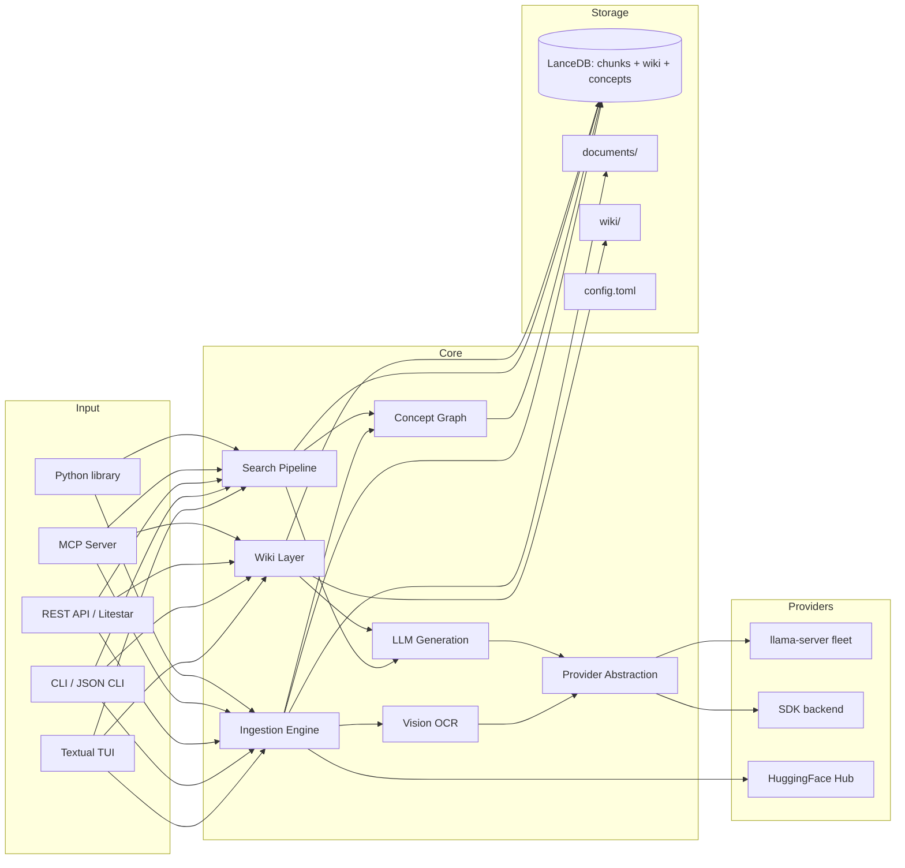

# lilbee architecture

lilbee is one executable that runs your models and searches your files with them. You point it at a folder (markdown, code, PDFs, Office documents, ebooks, images), and it indexes the files. Then you search them, chat with a model that answers from them, or let lilbee build a wiki of the concepts and entities they contain. Every answer cites the source chunk.

It needs no cloud and no API key. It contacts a cloud provider only when you set an API key for it: once to check the key, then only for a cloud model you pick. The same process drives the CLI, the TUI, the REST API, the MCP server and the Python library. No sidecar services run beside it.

This document shows how the parts fit. Each section links to an internals page with the full detail.

## System overview

Every surface calls the same core. No surface owns logic that another lacks.

## Process boundaries: engine out of process, retrieval in

One rule decides every process boundary: **a separate process is warranted only where
the kernel cannot share the resource through the filesystem.**

The engine qualifies. VRAM is per-process and a C++ inference crash must not take the
app down, so llama-server runs externally behind llama-swap over localhost HTTP. The
hop carries token streaming, where transport cost is noise next to per-token compute.

The retrieval index does not. LanceDB is an embedded mmap'd store: queries read index
pages in-process, and the OS page cache shares those pages across processes for free.
In-process retrieval is already shared retrieval.

What this buys:

- **No transport on the hottest read path.** Candidate sets flow between search stages
  as in-memory objects, not round-trips.
- **Search cannot be "down."** No retrieval service to start, health-check, or crash.
- **Library-first, CLI-first.** `lilbee search "q" --json` boots, maps the index, runs
  the full pipeline, prints, and exits. No server, no daemon.
- **Concurrency scales with processes**, not a shared service's event loop.

The price is write coordination: writers serialize through a cross-process file lock
and readers tolerate a bounded staleness window (LanceDB MVCC, 5s read-consistency).
Cheap for a read-heavy knowledge base. Surfaces that cannot run in-process still get
the full pipeline over HTTP via `/api/search`.

## Ingest

Discovery hashes each file, so lilbee indexes only what changed. Xberg reads 120+ file types and splits them at headings. tree-sitter splits code by function and class. Scans go through Tesseract or a vision model. crawlberg saves web pages as markdown under `documents/_web/`. The embedder runs on every GPU, and lilbee sizes each batch to keep them busy.

Details: [ingest internals](internals/ingest.md).

## Models and GPUs

Chat, embedding, vision and rerank are four model roles. Each role resolves to a provider at call time, so local and cloud models mix freely.

The local provider is a fleet of `llama-server` processes, one for each role. A planner sizes each model with gguf-parser and places all roles together across the GPUs. If a chat model is too big for one card, the planner splits it across the fewest cards that fit. A supervisor starts each server on first use, checks its health, restarts it after a crash and removes orphans. A router sends each call to the least busy healthy server.

Details: [engine internals](internals/engine.md).

## Search

A question goes to a route by its shape: a count, a named document, or a topic. A topic search runs keyword and vector search together and merges them with reciprocal-rank fusion. Query expansion runs only when the first keyword probe is not confident. An optional cross-encoder reranks the results, a cap keeps one source from filling the context, and every chunk goes to the model with a header that names its source. If no result passes the relevance floor, lilbee says it cannot answer.

Details: [search internals](internals/search.md).

## Wiki

The wiki has one page for each concept or entity, not one for each document. lilbee checks every citation against the source text before a page publishes. Pages below the quality score wait in `drafts/` for review. Wiki pages are searchable with your documents.

Details: [wiki internals](internals/wiki.md).

## Interfaces

The CLI (Typer), the TUI (Textual), the HTTP server (Litestar), the MCP server and the Python library (`from lilbee import Lilbee`) share one set of services. The HTTP server also serves OpenAI-style `/v1/chat/completions` and Anthropic-style `/v1/messages`, which `lilbee launch` uses to connect coding agents. The MCP server runs over stdio, or over HTTP with a bearer token.

Details: [interface internals](internals/interfaces.md).

## Configuration

Settings come from env vars (`LILBEE_*`), then `config.toml`, then the defaults. The TUI, MCP and HTTP surfaces write the same settings. The [settings reference](settings.md) lists every setting and the surfaces that can change it.

Details: [configuration internals](internals/config.md).

## Release

Nuitka compiles lilbee and its Python runtime into one file for each platform and GPU build. The engine ships as the `lilbee-engine` wheel on lilbee's own package index. The package managers wrap the same binaries.

Details: [release pipeline](internals/release.md).

## Decisions

- **Build on mature tools.** llama.cpp runs the models, LanceDB stores the index, Xberg reads documents, crawlberg crawls. lilbee owns placement, retrieval and the surfaces.
- **One executable, nothing to operate.** No daemon is required. Each surface starts on demand and exits when you close it.
- **Local first.** lilbee sends no telemetry. Your files and questions go to a cloud provider only when you set its key and pick its model.
