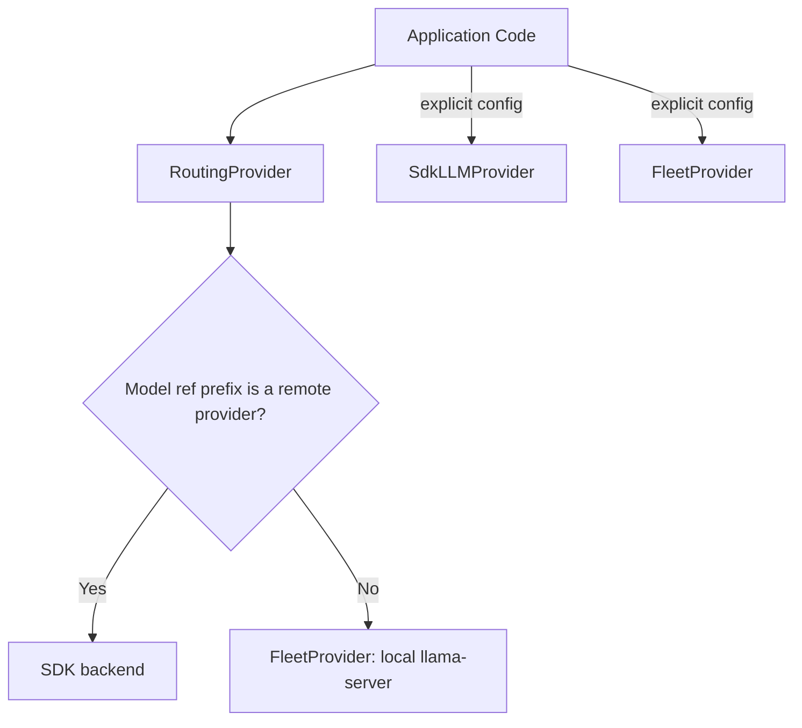
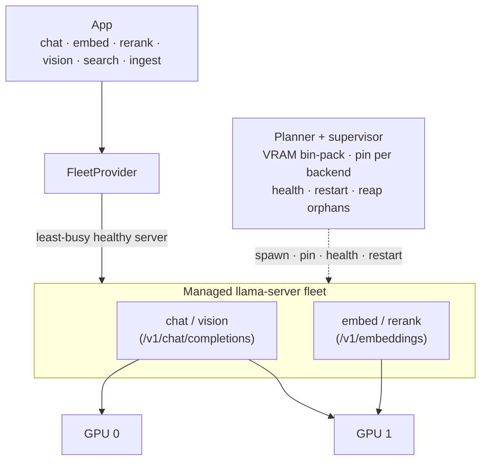
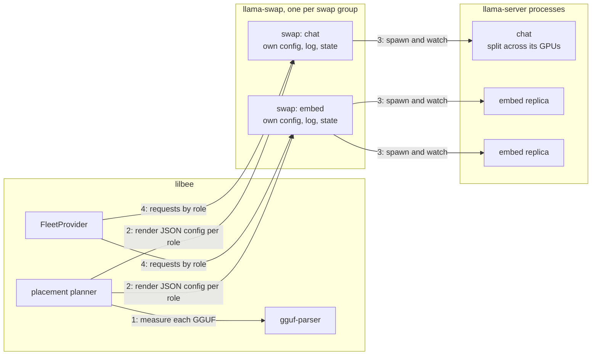
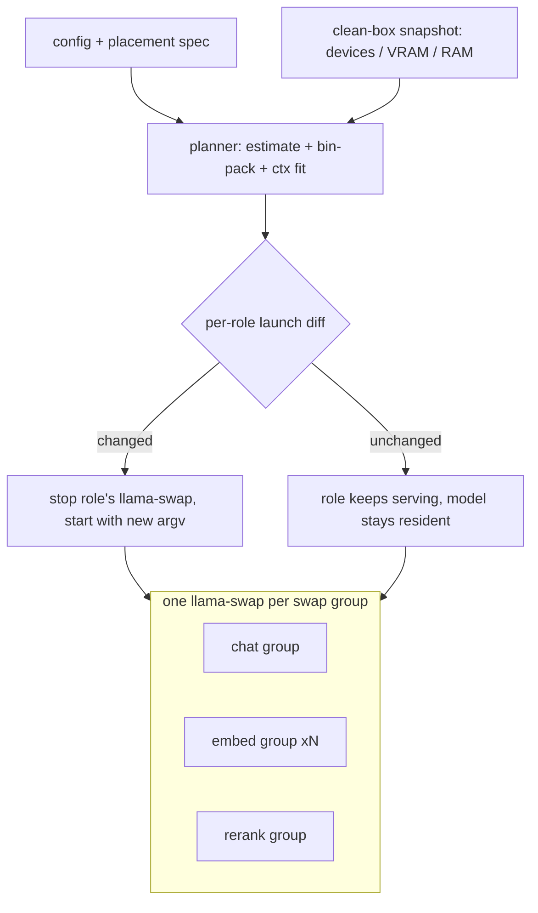
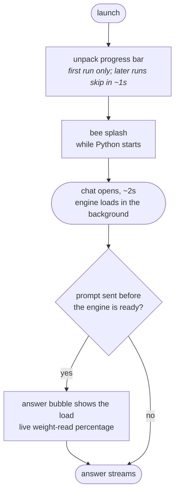
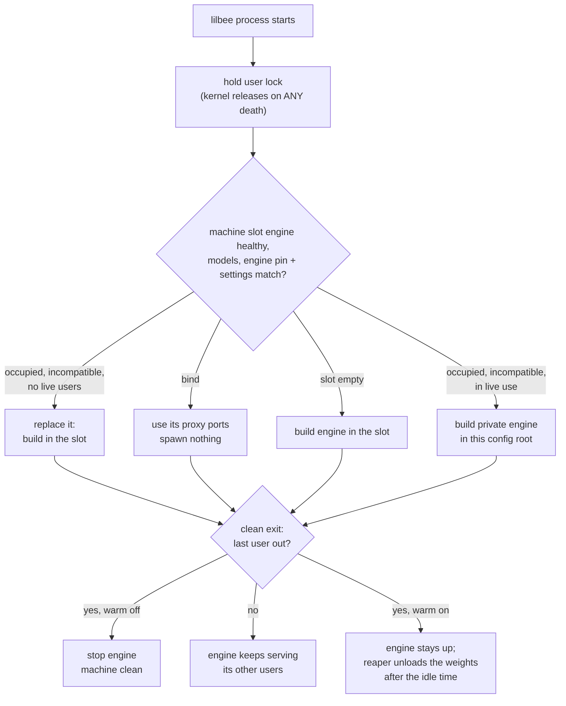

# Engine internals

How lilbee runs models: the provider layer, the llama-server fleet, GPU placement, startup and the context window. For the overview, see [Architecture](../architecture.md).

## Provider Abstraction

lilbee treats chat, embedding, vision (OCR), and reranking as independent **model roles**. Each role resolves to a provider at call time, so you can mix local and remote freely (e.g., a local GGUF chat model with a remote embedding model, or the reverse).



- **auto** (default). `RoutingProvider` dispatches by model-ref prefix: a remote ref (`ollama/`, `openai/`, ...) goes to the SDK backend; a native GGUF ref runs locally on the managed `llama-server` engine.
- **remote**. Force all calls through the SDK backend (any provider the SDK reaches). Requires `pip install lilbee[providers]`.

**Model roles** (`lilbee model list --task <role>`):

| Role | Config field | Used for |
|------|--------------|----------|
| chat | `LILBEE_CHAT_MODEL` | `ask`, `chat`, wiki generation |
| embedding | `LILBEE_EMBEDDING_MODEL` | ingest, search, faithfulness scoring |
| vision | `LILBEE_VISION_MODEL` | OCR for scanned PDFs and images |
| reranker | `LILBEE_RERANKER_MODEL` | cross-encoder precision pass |

`validate_model_task_assignment` (invoked at config write time) rejects assignments where the model's capability declaration doesn't match the role, so you can't accidentally wire a pure-chat model into the vision slot.

**Model management.** Native GGUF support tracks [llama.cpp](https://github.com/ggml-org/llama.cpp) 1:1, so any GGUF that `llama-server` loads loads in lilbee. Pulls come from HuggingFace via the catalog (`lilbee model pull`, `/models` in the TUI). Picks per role are the most popular models of each parameter tier, fetched live from HuggingFace's trending ranking and held for the session; the catalog view additionally exposes the full HuggingFace GGUF search. External models reached via the SDK backend are used for inference when available but are not managed by lilbee.

---

## Local inference engine

The local engine is a managed `llama-server` fleet (`FleetProvider`,
`src/lilbee/providers/fleet/`): lilbee starts one `llama-server` per
configured role, routes each call to the least-busy healthy server for that role,
and tears them down on exit. A single machine is a fleet-of-one; the same code
scales to N GPUs by bin-packing models across them. Placement is planned jointly
for every configured role up front, but each role's server spawns lazily on first
use, so a batch `lilbee add` that only embeds never loads the chat model's VRAM;
the interactive warm-up (`worker_pool_eager_start`) brings every role up at once. There is no separate engine to
install or run, and no in-process binding: the engine is 100% llama.cpp, and lilbee
adds a placement planner, a process supervisor, and a thin httpx router. All four
roles run over HTTP: chat and vision use `/v1/chat/completions` (chat with
`--jinja` for native tool calls; vision adds an `--mmproj` projector), embed and
rerank use `/v1/embeddings` (rerank with `--pooling rank` and a
`query</s></s>candidate` pairing, never the template-dependent `/v1/rerank`). A
configured role whose server cannot start surfaces a user-facing `ProviderError`
rather than degrading silently.



#### Supervision layout

Follow the numbers: the planner measures, renders a config per role, each role's
llama-swap spawns and watches that role's servers, and the provider routes live
requests by role. Rerank and vision follow the same shape as embed. Because every
role has its own supervisor, config, log, and state file, a placement change
restarts only the roles whose launches changed (see the reload diff below).



- **Detection** (`devices.probe_devices`): GPUs come from the binary's own
  `llama-server --list-devices`, so enumeration and pinning share one backend-native
  index space. A device index from one API (Vulkan) is meaningless to another (CUDA),
  so we never cross them; the Vulkan VRAM probe (`gpu_select`) is only a fallback.
  The probe runs in its own process group with a hard timeout: a probe wedged in
  GPU-driver I/O is killed (and abandoned if unkillable) and surfaces as a named
  error through the warm tracker, health, and the TUI, never as an empty device
  list or a silent never-ready fleet.
- **Pinning**: per backend, never by a foreign index, and in two shapes depending on
  whether the backend's environment variable speaks the same space `--list-devices`
  numbers.
  - By name, via `--device` (`planning._device_names`): **Vulkan** and **SYCL**.
    `GGML_VK_VISIBLE_DEVICES` indexes the raw loader enumeration, not ggml's
    filtered list, and setting it also disables ggml's device-type filter, its
    `storageBuffer16BitAccess` support check and its same-UUID dedup.
    `ONEAPI_DEVICE_SELECTOR` is a selector over a backend runtime rather than an
    index list, so a device the engine calls `SYCL1` need not be Level Zero
    ordinal 1. `--device` names devices exactly as `--list-devices` printed them,
    which is where the indices came from. Devices synthesized by the Vulkan
    fallback are never pinned: they carry raw loader ordinals, so the engine is
    left to select for itself.
  - By environment (`devices.visible_env`): **CUDA** via `CUDA_VISIBLE_DEVICES`
    with `CUDA_DEVICE_ORDER=PCI_BUS_ID` (a preset order is replaced with a
    warning), **ROCm/HIP** via one of `ROCR_VISIBLE_DEVICES`/`HIP_VISIBLE_DEVICES`
    (never both: ROCr filters first and HIP re-indexes within the survivors, so
    writing both double-filters). When the parent environment already restricts a
    visible-devices var (a pod preset like `CUDA_VISIBLE_DEVICES=2,3`), the probe's
    indices are relative to that list, so the child env maps them back through it
    (integer or UUID entries) and keeps naming the same physical cards the probe
    saw.
  - When the engine listed GPUs and placement refused all of them, the launch
    carries `--device none`: dropping a device from lilbee's view does not stop
    ggml choosing it, and its fallback takes the first non-CPU adapter.
- **VRAM estimation** (`vram.py`): each instance's footprint comes from
  **`gguf-parser`** (`estimate_instance_footprint`), a UMA-aware estimator run as a
  subprocess and memoized on the GGUF's path + mtime + sizing. It reports both a
  discrete-GPU footprint (`nonuma`, what lands in device VRAM) and a unified-memory
  footprint (`uma`, total resident on an Apple Silicon / shared-RAM host); the
  planner charges whichever matches the host. For a multi-GPU tensor-split it passes
  `--tensor-split`, so gguf-parser returns the **per-device** breakdown; placement
  then charges each card its own share and gates on each card's headroom, with the
  busiest card (`peak_footprint`) as the binding constraint, because a split OOMs on
  whichever GPU is fullest, not on the summed total. The estimate also carries the
  same `--batch-size`/`--ubatch-size` the launch will use (pooled embed/rerank raise
  them to the full context), so the compute-buffer estimate matches what the server
  actually allocates. For a vision model the discrete-GPU number is corrected on
  lilbee's side: gguf-parser's `nonuma` merge charges any multimodal projector
  roughly 10 GiB of phantom compute buffer (a 1.2 GiB OCR model plus its 0.9 GiB
  projector came back as 12.7 GiB), so the projector is instead charged at its
  unified-memory delta, floored at the projector's own weights. This replaced a
  hand-rolled
  weights + KV-cache estimate that used discrete-GPU accounting and over-estimated
  ~3x on unified memory, which was crowding the co-resident embed/rerank servers out
  of the budget and 503-ing every search.
- **Placement** (`placement.py`): bin-packed in `placement_rank` order (search roles,
  then vision, then the elastic chat model), largest-first within a rank, with 90%
  headroom.
  A model that fits one GPU is a single pinned instance; small models co-locate; a
  model too big for one GPU is tensor-split across enough cards that each card's
  per-device footprint fits, charged against each card's total VRAM capacity (so a
  warm fleet's own resident models aren't double-counted, and unequal GPUs don't OOM
  the smaller one). For the chat model the planner does not stop at the fewest fitting
  cards: it sizes each candidate shard's served context the way the launch will
  (`ctx.fit_split_ctx`, against the **clean-box plan snapshot**) and **widens onto idle cards** when
  a tighter shard would starve KV below the context target, falling back to the
  largest-context shard when no shard reaches it. This keeps placement and launch in
  agreement, so a giant chat that just fits the fewest cards no longer collapses to the
  512-token floor while spare cards sit idle; a chat already comfortable on few cards
  stays there (no needless inter-GPU traffic), and the context target follows
  `cfg.num_ctx` / `cfg.chat_n_ctx_target`. A tensor-split chat serves **one full-context sequence**
  (`--parallel 1`): a giant filling several cards has no room to divide its context
  across batching slots, so the planner reserves and launches it at the single-sequence
  footprint rather than `ceiling x` the single-GPU slot count (multi-slot batching is
  for a chat that fits one card). Its context is then sized (`ctx.fit_split_ctx`, a
  binary search over the gguf-parser estimate) so **each card's own share fits that
  card's own headroom**, never the combined pool, so the per-GPU compute buffer can't
  overflow device 0 even when the cards are unequal. A chat on one card searches the
  same grid against one device (`ctx.fit_single_ctx`, entered through
  `engine_params.resolve_chat_ctx`), so both paths price the cache the model's
  architecture holds. **llama-server's own fit places the layers** (`--n-gpu-layers -1`):
  lilbee keeps the window, the slot count and the cross-card placement, and sends
  `--fit-target` per card: the engine's own 1024 MiB margin plus the memory held for the
  roles that load after chat on that card (vision, which warms on the first OCR). Embed
  and rerank warm before chat, so the card's free memory already excludes them when the
  fit runs. When full offload leaves KV room for less than a grounded
  prompt (`planning.fit_chat_ctx`), the window is raised to the smallest one that answers
  and the fit moves dense layers or MoE experts to system memory to hold it. That needs
  the fit to run: an auto layer count, no expert overrides, a card with memory of its
  own, and an engine whose `--help` lists `--fit-target`. When the engine reports more
  of chat in system memory than the estimate expects with every layer on the card, the
  readback warns once. The fit reads free memory at load, so roles that share a card warm
  one at a time, chat last (`provider._warm_chains`). Chat slots share one KV pool (`--kv-unified
  --kv-unified-per-slot <window>`), sized at slots x window as before, on an engine whose
  `--help` lists the per-slot cap.
Header math (`model_cache.compute_dynamic_ctx`) is the fallback
  for when gguf-parser cannot answer; it charges every layer as dense attention over
  the whole window, which under-grants linear-attention, sliding-window and MLA models. On a
  single CPU/Metal box this
  is a fleet-of-one against one shared pool, where the **search-critical roles
  (embed/rerank) are reserved before the elastic chat model**: chat's slot count and
  context are sized against the budget *minus* the search footprint, and the shared
  pool places search first, so a large chat can never starve search (the proven
  embed-starvation bug). Placement gates against **free system RAM** rather than a
  GPU budget: unified memory is shared with the OS, so a model that exceeds free RAM
  is marked unplaceable (no server, clean error) instead of loaded. Loading past free
  RAM on a unified-memory host drives the OS into a swap-thrash OOM livelock that
  hard-freezes the machine, so refusing is the safe outcome; chat slot count
  (`--parallel`) steps down the same way before refusing.

- **A role that a tensor-parallel engine splits over several cards**: the launch runs as equal tensor-parallel
  shards and carries no layer flag. Placement offers such an engine only equal
  shares, so on cards of different sizes the smallest card must hold its equal share
  or the role is refused. The card order is the order of
  `CUDA_VISIBLE_DEVICES`. A launch that is not a split turns the card collectives off: one
  card, no card pinned, or the CPU target. A split sets `NCCL_P2P_LEVEL=NVL`, so
  peer-to-peer runs only over NVLink and a PCIe pair does not stall at start. To
  choose otherwise, set `NCCL_P2P_LEVEL` or `NCCL_P2P_DISABLE` in the environment;
  the launch then adds neither. The engine drops a layer map when
  collectives are on, and the map it keeps with collectives off answered wrongly on
  two cards. So the launch refuses an uneven ratio (every entry must be the same
  number) and a model whose attention heads do not divide over the card count (the
  GGUF `head_count` and `head_count_kv`, or `num_attention_heads` and
  `num_key_value_heads` in `config.json`). The message names the model and the
  llama.cpp engine as the fix, as it does for a Metal or CPU build. Placement charges
  each card its layer share of the estimate. For a model folder the estimate is the
  weights, the cache at the launch context and the runtime allowance. For a GGUF file
  it is the weights only. Every chat or vision launch, split or not, also passes
  `--max-model-len` with the context of the launch: the `num_ctx` pin, else
  `chat_n_ctx_target` within the trained window and `num_ctx_max`. A split passes the
  largest context that fits each card, never more.

- **Reload and the plan snapshot** (`planning.capture_plan_probe`,
  `provider._reload_pass`): each swap group runs behind its own llama-swap process
  (one per role, except the co-tenant roles, which share one), and a reload
  re-plans the whole fleet but restarts **only the groups whose launches
  changed**. That diff is sound because launches are a pure function of config,
  hardware capacity, and a **clean-box memory snapshot**: devices, usable VRAM,
  and free system RAM are captured once per boot (right after stale-server
  reaping, when nothing lilbee owns is loaded) and every re-plan reads the
  snapshot instead of probing live. A live probe under a loaded fleet would
  report the fleet's own residency as unavailable, shrinking chat context and
  slot counts, widening splits, and (on unified memory) evicting roles outright.
  Full fleet teardown clears the snapshot, so the next boot probes fresh and
  still respects VRAM other processes hold. The read/view surfaces
  (`GET /api/placement`, `placement show`, preview) keep a live short-TTL probe
  so displayed free bytes stay current; they never feed the launch path.



#### Manual placement

By default the auto planner runs every time a fleet is built. When a `placement`
spec is set, it replaces the planner entirely: the spec's assignments are used
as-is and the VRAM bin-pack does not run.

The spec is per-role. Each role entry accepts:

- `devices` (required): list of GPU indices to use for that role.
- `tensor_split` (optional): per-device weight proportions for a tensor-split
  instance. When omitted, the model is split evenly across the listed devices.
- `replicas` (optional): how many independent servers to run for embed and
  vision roles. Defaults to 1.

```json
{
  "chat":    { "devices": [0, 1], "tensor_split": [1, 1] },
  "embed":   { "devices": [2], "replicas": 2 },
  "rerank":  { "devices": [2] },
  "vision":  { "devices": [3] }
}
```

The `placement` field is stored as a JSON scalar in `config.toml` (a single
`placement = '{"chat": ...}'` key), because the config store is a flat
key-value file and cannot represent the nested shape natively. The placement
surfaces (CLI, HTTP, MCP, TUI) handle encoding and decoding; editing
`config.toml` by hand is not the intended path.

When a pinned placement no longer fits the card it names, lilbee surfaces a
hard error that identifies the card by name (e.g. `CUDA0: RTX 4090
(23.7 GiB free, 24.0 GiB total)`) rather than failing silently. This makes
hardware-change failures explicit.

The surfaces go through the one `app/placement.py` use-case:
CLI (`lilbee placement show/preview/set/clear`), MCP
(`get_gpus`, `get_placement`, `preview_placement`, `set_placement`, `clear_placement`),
and the TUI Placement screen. Over HTTP the reads are always served
(`GET /api/placement`, `POST /api/placement/preview`, `GET /api/gpus`).
Applying or clearing placement restarts the fleet's moved roles, so `PUT`/`DELETE
/api/placement` are refused by default and gated on `allow_http_placement`
(`LILBEE_ALLOW_HTTP_PLACEMENT`), which an operator enables for a single-client
or owned deployment (the plugin's managed server, or a personally-owned pod) to
get the same apply/clear capability as the CLI and TUI. The `preview` operation is a dry-run: it shows
what the auto planner would assign (or what a candidate spec would assign)
including each card's backend+index label, name, and free/total VRAM, without
touching the running fleet.

The `GET /api/placement` response lists the engine's devices in `gpus`. On a
Vulkan build, a machine with GPUs from two vendors hides one vendor's GPU from the
engine at launch, so `gpus` has no row for it and no pin can name it. The
`hidden_gpus` field lists the vendor names of that hidden hardware, for example
`["Intel"]`. The field is an empty list when nothing is hidden, and it stays
empty when `VK_LOADER_DRIVERS_DISABLE` is set before launch, because the engine
then lists every GPU. `lilbee placement show` prints the same fact as a note
under the table.

When a saved spec is not in use, `refusal` holds the reason in words and
`refusal_kind` names the case: `waiting_for_engine` or `waiting_for_model` when the
spec applies once an engine or a model is installed, `unreadable` when the saved
text cannot be parsed, and
`refused` when an engine refuses roles, the spec places no role on this
machine, or a saved spec does not fit the hardware: for that last case `refusal`
holds the planner's sentence and `refusal_kind` is `refused`, and the reply also
carries `rejected_spec_json`. The field is null when there is no refusal.
A client reads `refusal_kind`, not the sentence, to decide whether the spec is
kept or must be corrected.

- **Resident tiers and the elastic ingest pool**: placement charges roles in the
  registry's `placement_rank` order. The pinned tier goes first: one embed server
  (`embed-0`), rerank, and one vision server (`vision-0`). Chat is charged last,
  against what the pinned tier leaves, because chat's KV cache is the one footprint
  that can shrink. Search therefore never loses its servers to a large chat model,
  and vision is placeable whenever it fits beside the search tier, no matter how
  large the chat model is. Extra embed and vision replicas (`embed-1..N`,
  additional vision) are placed only into the VRAM that remains, and stay resident
  there; nothing is unloaded when an ingest finishes. If llama-swap is restarted or
  found dead, the fleet re-probes once and rebuilds its model config before
  reporting a failure.
- **Swap tenancy**: the planner matches the old in-process pool (last shipped in
  v0.6.66b507; see its
  [Inference Worker Pool](https://github.com/tobocop2/lilbee/blob/v0.6.66b507/docs/architecture.md#inference-worker-pool)
  section), where a role's worker spawned lazily on first call, so ingest
  (embed + vision OCR) and a query (embed + rerank + chat) never held each
  other's models in VRAM. Roles that share
  no run **phase** (`RoleInfo.phases`) are never resident together, so when they
  cannot all co-reside a role that does not fit **refunds** the already-charged
  phase-disjoint roles and retries; the roles that let it in become co-tenants of
  one swap process. On a tight card this pulls the query-only rerank and chat into
  vision's swap process, so ingest's embed + vision fits exactly as it did
  in-process. The co-tenants split into **residency classes**: roles that share a
  run phase (chat and rerank both answer one query) stay loaded together, and
  loading a role of another class evicts them. One router group holds each
  class (`swap: false`, `exclusive: true`, `persistent: false`), so the router
  itself does the eviction. Placement first packs the fleet as before, each
  co-tenant in a class of its own. It then merges chat and rerank into one class only
  when the class fits in the room left after every role is placed; otherwise they
  stay apart and evict each other, as every co-tenant did before. A tight role holds what is left
  of its card and joins no class. The swap process is charged its largest class,
  the members of that class added up, and each co-tenant runs a single instance
  (the elastic tier does not replicate a role inside the process). Interleaving a
  query with an ingest costs a model reload each way. With the VRAM to hold
  everything at once, no swap group forms and every role
  pins to its own group. A plan with several engines on discrete cards gives each
  role a named card or a refusal, and a refused role takes no card. It checks three
  causes in order: the engine cannot be pinned on several cards (it reports another
  backend, or takes neither the visible-devices variable nor device names), the role
  is larger than the largest card and no split holds it, or no card has room beside
  the other roles. If small roles spread over the cards block a large one, a second
  pass places the largest role first, and it wins only when it refuses a strict
  subset of the roles. The warning names the engine and the cause. A plan with
  several engines on shared memory stays on the shared-memory budget below. With one
  engine, the estimate advises but does not gate the load on GPUs: a
  role that does not fit even beside the one embedder its own phase needs is still
  **placed tight** (best-effort) on the emptiest card, anchoring the swap group so the load
  starts against as much free VRAM as possible, with a memory-is-tight warning
  carrying the estimated shortfall. The in-process pool never gated a load on an
  estimate, and the load itself is the only reliable arbiter (the estimate can be
  high, and some drivers page into shared memory rather than fail). The one
  exception is not about whether the load succeeds: a chat whose **fitted window
  cannot hold the minimum grounded prompt** (system prompt, one retrieved source,
  the question, and the answer reserve) would load, report ready, and then fail
  every query at the window, so `plan_launches` refuses that launch and records a
  reason with the numbers, surfaced by the warm tracker and the request path. A
  `num_ctx` pin, or a `num_ctx_max` / `chat_n_ctx_target` the user set below that
  minimum, is honored instead of refused.
- **Data-parallel replicas** (`embed_replicas` / `vision_replicas`): the embed and
  vision roles can run as N independent servers, fanning embedding and OCR across
  the box during ingest. Setting either value to `0` (the default) means auto: one
  replica per GPU, capped by how much VRAM remains after the query fleet is placed.
  A positive value pins the replica count to exactly that number. The provider
  holds a client pool per role and round-robins to the least-busy replica. Each
  replica is its own llama-swap model id (`<role>-<n>`); a role is ready once any
  replica is. Replicas are ingest-only and reclaimed after ingest completes.
- **Loader flags** (`adapters.build_server_argv`): each server's flags derive from
  cfg and the model's GGUF metadata for that role and config. Chat carries
  `--jinja`, `--flash-attn` (on, or `auto` on Vulkan and SYCL, unless
  `flash_attention` is disabled) and
  `--cache-type-k/-v` from `kv_cache_type`. K and V always carry the same type,
  because llama-server refuses different ones on MLA models. A quantized type is
  sent only with flash attention `on`: under `auto` it would force flash attention
  on, and under `off` the server refuses it, so both fall back to f16 there (and
  the estimate sizes against f16 to match). A mixture-of-experts model also offloads its expert
  weights to system memory when `cpu_moe`/`n_cpu_moe` is set (`--cpu-moe`/
  `--n-cpu-moe`, gated on the GGUF declaring routed experts), and the VRAM estimate
  charges the same tensors to the host so the plan matches the launch. Chat on a network
  filesystem loads without mmap (a malloc'd host copy) when its weights fit in
  85% of total system RAM, because page faults served over the wire can wedge
  the loader. The flag is the one the binary's `--help` lists: `--load-mode none`
  on a current build, `--no-mmap` on an older one, and none when it lists
  neither, since each build refuses the other's flag at startup. Local disk and
  the other roles keep mmap. The gate reads total (not free) memory so replans never
  flap the flag; embed and rerank raise
  `--batch-size`/`--ubatch-size` to the full context (the server caps embeddings at
  `n_ubatch`, default 512); vision uses the full-core thread default and always
  offloads every layer. Embed and rerank requests also send `embd_normalize=-1` to
  get raw, un-normalized vectors (the server would L2-normalize pooled output by
  default, which would also collapse a rank score to +-1). Context and GPU-layer
  counts come from the shared `engine_params` helpers, never a hardcoded budget.
  No launch sends `--main-gpu`: llama-server reads it only under split mode
  `none`, and a server sees only the cards it was placed on. `gpu_devices` and
  `placement` choose the cards; a `main_gpu` key in `config.toml` or a
  `LILBEE_MAIN_GPU` variable is refused with a warning at load.
- **Lifecycle** (`swap_manager.py` / `provider.py`): each swap group runs behind its own
  llama-swap process with its own config file, so restarting one group (a placement or
  per-role model change) never touches another group's loaded servers. A reload
  re-plans the whole fleet and diffs the fresh plan per group against the
  running launches, restarting only the groups whose launches changed; an
  untouched 100GB chat model stays resident while the embedder moves. llama-swap
  answers 429 once a model has `concurrencyLimit` requests in flight and never
  queues them, so each model's config sets that limit to four times the larger of
  its slots and the ingest pool: one engine serves every lilbee process, and
  llama-server queues past its slots by itself. A 429 is then reported to the
  caller as a busy model, not retried; gateway errors (502/503/504) from a
  restarting server are retried with backoff. Each
  server runs in its own process group and claims
  its port at spawn (no racy batch allocation). Readiness is `/health` (200 only once
  the model loads); the cold-load health timeout scales with the heaviest member's
  weights at a conservative disk rate (a ten-minute floor, two minutes for the embedder,
  whose small weights load in seconds), so a multi-hundred-GB model
  on a slow volume isn't killed mid-load. Each owner lilbee writes one state file per swap group
  (named with the group and its pid, written atomically so a concurrent scan never reads a torn
  file) recording that group's llama-swap pid, process group, and create time, the
  member servers' ports, plus the owner's pid and create time, and `ready_at` once the builder sees a load succeed. A
  later lilbee binds an answering engine only when `/running` lists a member ready or starting, or the record has
  `ready_at`, or the record is younger than the slowest member's cold-load ceiling plus 30 s, or another lilbee holds
  the engine (a holder that never warmed leaves no proof of a load); an older record that never loaded and has no
  holder is rebuilt. Before the next build
  launches the fleet (so the cards are actually free for it and the context sizer
  reads true free VRAM), every state file is
  scanned and each dead owner's surviving llama-swap and its servers are reaped
  (guarded against pid reuse by create-time matches for both the swap and the owner,
  falling back to a command-line match for legacy files, and left alone while the
  owning lilbee is still alive; an unparseable file is skipped, never deleted, since
  it may be a sibling's in-flight write). Servers that outlive a dead swap (each runs
  in its own process group) are matched by binary name plus recorded port and stopped
  the same way; force-killed processes are waited on so the VRAM probe sees their
  memory actually freed. Clean shutdown removes only the
  owner's own file. A background monitor restarts a dead server with
  backoff, and the router serves only healthy clients. Teardown group-kills (SIGTERM
  then SIGKILL).
- **Routing** (`provider.py`): each role goes to its least-in-flight healthy server;
  rerank reuses the client's rank-pooling embeddings call and vision the chat call
  with image content. A connection-level failure marks the replica unhealthy and the
  embed/rerank call retries once on a different replica; an unhealthy replica rejoins
  the pool after a short cool-down, where recovery is probed by live traffic and
  unmetered: every caller that routes to it once cooled is a probe (a success
  restores it, another connection failure re-starts the cool-down).
  A per-call model that differs from the role's configured model
  is rejected (switching models is a config change that respawns the server), and a
  role with no healthy server surfaces a `ProviderError`. Fleet build is single-flight
  and the in-flight counter is atomic, because the HTTP and MCP servers route concurrently.
- **Binary** (`binary.py`): the bundled wheel ships `llama-server`; resolution falls
  back to `LILBEE_LLAMA_SERVER_PATH` / PATH. Never auto-downloaded.
- **Delegate alternative:** to use an external fleet (GPUStack, vLLM), point the
  `remote` provider at it (`LILBEE_LLM_PROVIDER=remote`); the managed fleet is the
  local, single-box option.
- **Hardware QA:** `tools/qa/multi_gpu_smoke.py` validates enumeration, placement,
  concurrency, restart, and orphan cleanup on a real multi-GPU host.

### Startup sequence and engine lifecycle

The TUI opens in a couple of seconds and the model loads in the background,
the way Ollama and LM Studio do. The startup gate
(`cli/tui/screens/startup_gate.py`) holds only while the services container
builds; anything slower than widget mounting (disk reads, server probes) runs
in the gate's boot worker. A prompt sent before the engine is ready waits in
its own answer bubble, which renders the live load phase with byte progress
(`wait_chat_ready(on_progress=...)` in `app/placement.py`).



The engine is machine-level infrastructure. One **machine engine slot** per
OS user (`~/.local/state/lilbee/engine/`, `~/Library/Application
Support/lilbee/engine` on macOS, `%LOCALAPPDATA%\lilbee\engine` on Windows)
holds the running fleet's records; every process acquires its engine
through the same ladder, under a cross-process build lock:

1. **Bind** when the slot's engine is healthy and its contract (per-role
   models, the bundled **engine pin**, and the settings each launch bakes in)
   covers the configuration. A write restarts a group only when its launch
   moves, so a kept group stays bindable. Binders
   spawn nothing and write nothing. lilbee version is not in the contract:
   releases sharing a pin share an engine; differing pins never run on a
   build they were not tested against. The pin carries the revision of the
   llama-swap config, so a release that writes a new config key never binds
   an engine started without it.
2. **Build** into the empty slot otherwise. An incumbent is replaced in place
   only when no live user holds it, so leftovers never poison the slot and no
   process stops an engine that another process is using.
3. **Overflow** to the config root's private dir (`<root>/data/engine/`) when
   the slot holds an engine with a live user that this process cannot bind: a
   different model setup, an added role or a dead group. The live engine stays
   as it is, and the joining process builds a private fleet beside it. If the
   private dir also has a live user that the process cannot bind, the process
   gets no fleet and no engine stops. Each request then names the cause and
   tells the user to close the other processes or set `LILBEE_ENGINE_DIR`.

Lifetime is kernel-refcounted membership: each process holds a user lock the
OS releases on any death. The engine belongs to that set of users, not to the
process that built it: it ends when no user lock and no keep-warm opt-in is
left, judged under the build lock. The last clean exit applies that rule
itself. For deaths with no exit hook, one engine reaper per engine dir
(`providers/fleet/engine_reaper.py`, a detached `python -m` process holding
`engine-reaper.lock`) polls the user locks once a second and applies the same
rule. Every build and every bind makes sure a reaper holds that lock, starting
one when none does, so a reaper that died is replaced by the next user. A
build spawns the engine unbound only after its reaper holds the lock; when no
reaper reports running, the engine is bound to its builder. On a filesystem
without kernel-arbitrated locks the users cannot be counted, so the engine is
bound to its builder (PDEATHSIG, a kill-on-close job object, or a death pipe).
`keep_engine_warm` opts the engine into outliving lilbee: it is spawned
detached, and its weights stay loaded while any lilbee process holds a user
lock. Each opt-in is a marker file that holds that installation's
`engine_idle_ttl_minutes`. When the last user leaves, the reaper counts that
idle time (the longest marker wins; 0 never unloads) and then calls llama-swap's
`POST /api/models/unload` on each recorded proxy port, under the build lock and
after it checks for users again. The engine process stays up, so the next
launch binds at once and its first request reloads the weights. To keep the
weights loaded while users remain, a build that is kept warm (by its own
setting or by any marker) starts llama-swap with TTL 0, but only where kernel
locks let a reaper count users. llama-swap fixes the TTL at launch, so a change
to either setting applies at the next engine start. Every other engine
unloads on the idle TTL (default five minutes) after its last request. Only an
engine bound to its builder takes the TUI's and a bulk ingest's no-unload hold,
because a shared engine outlives the holder. The command
`lilbee engine stop` frees everything now, whoever started it. Reaping never
disagrees with binding: an engine answering on its proxy is spared, anything
else is stopped through its state record.

Two costs ride along. A model or placement change in the process that built
the engine restarts only the moved groups; a process that only binds drops its
binding on a setting write and re-acquires, and may overflow to a private
engine. No process rereads load settings, so a peer that holds the old value of a
moved setting no longer matches the restarted engine and builds a full private
fleet at its next acquisition. Peers rediscover the new ports with a one-shot retry, and an in-flight
request surfaces a retry error. And the proxy still listens on an
unauthenticated localhost port; the machine slot only makes discovery easier.



A SIGKILLed last user cannot run its exit hook, so the reaper stops the
engine within about a second of the death. A reaper killed while its engine
serves is replaced at the next bind. A user that withdraws `keep_engine_warm`
while other users are bound makes sure a reaper watches the engine in the same
way. The remaining gap is a killed reaper when every user then dies before
any user binds again: the engine keeps running with nobody watching, and a
kept-warm engine keeps its weights loaded. The next
lilbee run adopts that same engine and starts a reaper for it, and the engine
ends when that run's users end. The only processes that can outlive a session are the engine's own, because another
lilbee still uses them or because the user opted into warm, and the reaper of
a shared engine. The reaper exits with the engine.

### Chat context-window management

The fleet provider windows the request messages to fit the served chat
context before sending them to llama-server (`_fit_chat_context` in
`providers/fleet/provider.py`, the fitting logic in
`providers/fleet/windowing.py`). The budget is the served `n_ctx` minus
a generation reserve (the request's `num_predict`, else a default) and
a safety margin; the oldest conversation turns are dropped until the
estimated prompt fits. System messages and the most recent turn are
always kept, and a kept suffix never starts with an orphan tool result
whose originating call was dropped.

The estimate does not tokenize the real rendered prompt (llama-server
renders the chat template server-side at inference time); it counts
characters at a conservative 3 chars per token and adds a per-message
overhead for role markers and template wrappers, so the window errs
toward dropping more rather than overflowing.

When even the system messages, tools, and the final turn exceed the
budget, the provider raises a `CONTEXT_OVERFLOW` `ProviderError`, which
the chat-completions route maps to a clean 400 `context_length_exceeded`
rather than a 500 from the server.
