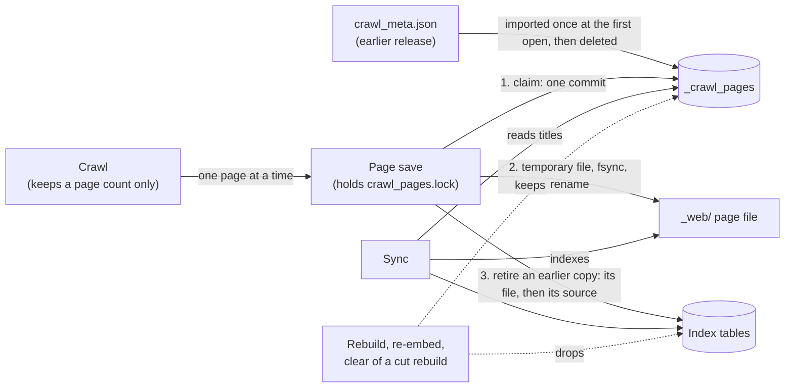
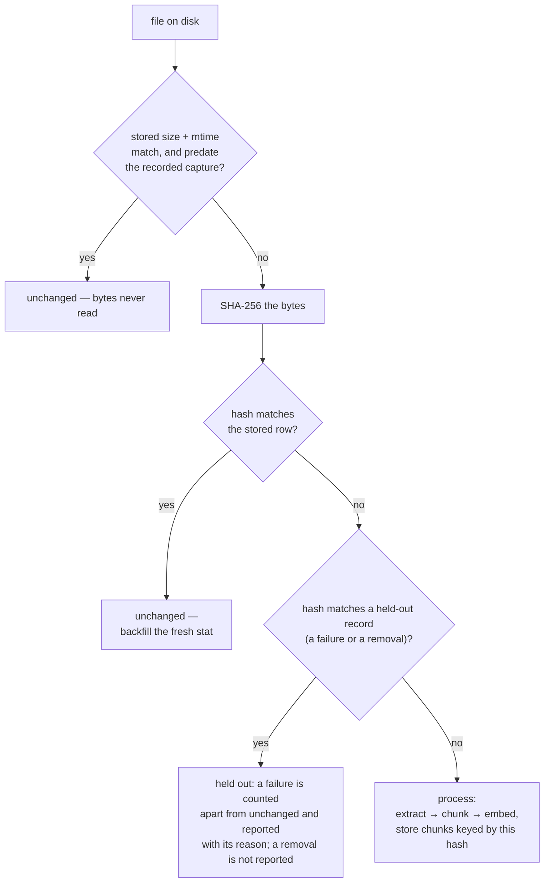
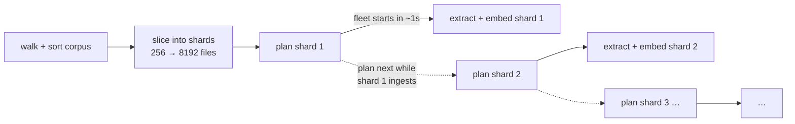
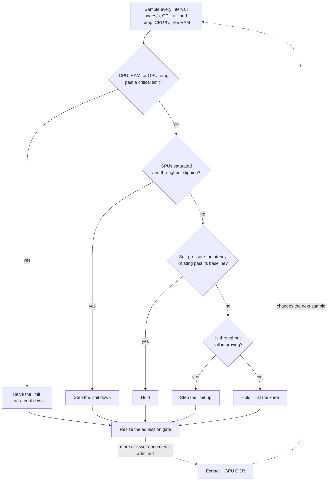
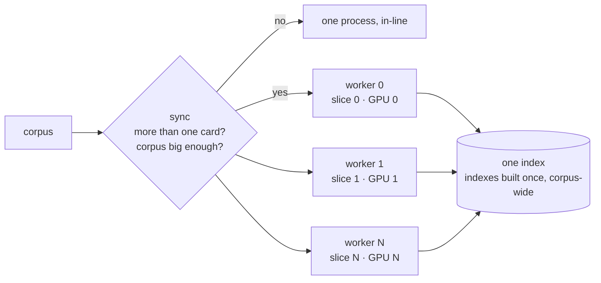

# Ingestion internals

How lilbee plans, chunks, embeds and stores documents. For the overview, see [Architecture](../architecture.md).

## Ingestion Pipeline

Documents are chunked, embedded, and stored as vectors for later retrieval.

- **File discovery.** Recursive walk of `documents/` with SHA-256 hash-based change detection so only modified files are re-indexed. Each source row also stores the file's size and mtime, so an unchanged file is skipped on a stat alone; the hash runs only when the stat pair drifts. Stores created before these columns re-hash once and backfill. This diff is streamed shard by shard so embedding starts before the whole corpus is hashed — see [Streaming the plan](#streaming-the-plan-start-embedding-before-the-corpus-is-hashed).
- **Markdown.** Heading-aware chunking via xberg's `chunker_type="markdown"`. xberg splits at heading boundaries and reports each chunk's enclosing headings in its metadata; lilbee prepends that hierarchy path (e.g., `# Setup > ## Install`) to the chunk so its section context travels with it. Inspired by Anthropic's Contextual Retrieval (2024), which showed adding context to chunks reduces retrieval failures by 49%.
- **Code.** tree-sitter AST splitting via tree-sitter-language-pack for 150+ languages, with symbol name, type, and line range in chunk headers.
- **PDF.** xberg text extraction with an OCR fallback chain (text extraction → Tesseract OCR → GGUF vision model on `llama-server`). PDF page rasterization is delegated to xberg's `PdfPageIterator`.
- **Vision OCR.** When `LILBEE_VISION_MODEL` is set, scanned PDFs and images are transcribed by a GGUF vision model served by `llama-server` with an `--mmproj` projector. The pipeline streams an SSE heartbeat during long scans and preserves tables, headings, and multi-column layout as structured markdown. Falls back to Tesseract when no vision model is configured.
- **Structured files.** xberg handles XML, JSON, JSONL, YAML, and CSV natively. Language detection for code-shaped content is delegated to tree-sitter-language-pack's `detect_language()`.
- **Web pages.** crawlberg fetches HTML over plain HTTP, or through a headless Chromium in browser render mode, converts it to markdown, and saves it to `documents/_web/` for indexing. Recursive crawls emit live progress, respect a per-domain rate limit, and retry on HTTP 429/503. SSRF protection blocks internal networks by default.
- **Chunking strategy.** Fixed-size chunking (default, token-aware) for reliability on procedural and reference docs. Opt-in semantic chunking (`LILBEE_SEMANTIC_CHUNKING=true`) splits at topic boundaries via xberg's ONNX embedding model; better on prose-heavy corpora at the cost of roughly 9x more downstream embedding calls.
- **Embedding.** Provider-agnostic: native GGUF on the local `llama-server` engine by default, or any backend reachable via the SDK protocol when `pip install lilbee[providers]` is available.
- **Asymmetric query/document embedding.** Instruction-tuned embedders (Qwen3-Embedding, e5/gte `*-instruct`) only reach their retrieval scores when the query carries a task instruction (`Instruct: ...\nQuery: <q>`) embedded differently from documents; base e5 uses `query:`/`passage:` prefixes. lilbee detects the family from the configured embedder ref and applies the right prefixes automatically (`retrieval/embedding_profiles.py`): the query path uses `embed_query`/`embed_query_batch`, the document path keeps `embed`/`embed_batch`. Symmetric models (bge-m3, nomic) and unrecognized models get no prefix, so behavior is unchanged for them. There is no instruction config: a wrong template silently underperforms, so support for a new family is a curated map entry, not a user knob.
- **Concept extraction (opt-in).** With `pip install lilbee[graph]`, spaCy noun phrases are extracted per chunk, a co-occurrence graph is built with PPMI weights, and Leiden clustering assigns concepts to communities.
- **Wiki generation.** Wikification is explicit: `lilbee wiki build` (or the TUI Wikify action, or the HTTP/MCP build endpoints) issues one LLM call per source; `lilbee sync` only runs the capped `lilbee.wiki.ingest.incremental_update` hook when `wiki_auto_update` is enabled. Each call jointly identifies 3–5 concepts worth their own page and drafts a section for each. Sections are citation-verified and embedding-faithfulness-scored before landing in `concepts/`, `entities/`, or `drafts/`. See the [Wiki Layer](wiki.md#wiki-layer) section.
- **Storage.** LanceDB tables: chunks (with FTS index for hybrid retrieval), sources, citations, wiki chunks, concept graph nodes/edges, and chunk-to-concept mappings.

### Saved names of web pages

A crawled page is saved as `_web/<host>/<folders>/<name>~<hash>.md`. Three separate mechanisms give the name its three properties:

- **Identity.** The canonical address is the key crawlberg gives the page: the WHATWG URL parse (ada-url), no fragment, the percent-escape forms of RFC 3986 section 6.2.2, and query parameters sorted by name. The crawl page table is keyed by this address.
- **Uniqueness.** `<hash>` is the first 16 hex digits of the SHA-256 of the canonical address. Lower-case hex survives every case fold and Unicode normalization, so no two pages share a file on any disk.
- **Legality and readability.** Each folder and `<name>` is a slug of one part of the address: decoded, NFC, letters, digits and `-_.@` kept, other runs written as `-`, at most 80 bytes, and a `_` before a Windows device name. The `<name>` comes from the last non-empty segment of the path, less its last suffix (`json.html` gives `json`, `file.tar.gz` gives `file.tar`, `.htaccess` keeps its text). It takes at most 99 bytes, with the `_` before a device name counted, so the host folder always fits, and a longer name is cut at the last `-`, `_` or `.` so no word breaks. A folder slug that ends in `.md` ends in `-md` instead, so no folder has the name of a saved file of this rule or an earlier one. An IPv6 host is written as its eight groups joined by `-`. A path with no non-empty segment gives the name `index`. The deepest folders are dropped until the path fits 200 bytes. A slug is lossy on purpose, because the hash carries the identity. A citation label shows the slug without the hash.

A name never escapes anything, so no escaping rule has to be both legal and one-to-one.

### The crawl page table and earlier copies

A crawl writes each page only at its name. Nothing moves a saved file in place: a page takes its name when its site is crawled again.



- **Crawl page table.** The `_crawl_pages` table in the index holds one row per page and file, keyed by address and file. Each address has one current row, which names the file the page owns; its other rows are earlier copies. A rebuild, a rebuild under another embedding model and the clear of a rebuild cut short keep the table, as they keep memories; only a reset deletes it. The current row also holds the hash of the text the file held before the save (`replaces`), so a save cut between its claim and its file is finished by the next crawl. The page file is written to a temporary file, synced, and put in place, so it never holds part of a text. A save adds a row and never rewrites one, so the table is folded every 100 commits and when a crawl that committed ends: the rows a later row of their key replaced are deleted, and the versions are compacted into one. A version a fold replaces stays readable for 10 seconds, so a reader in another process still reads it.
- **Crawl lock.** A page save holds `crawl_pages.lock` beside the table, not the index write lock, for the check, the claim, the file write and the retire of earlier copies. So a save never waits behind a sync batch. The claim commits before the file is written, so a file at a page's name always has a row. The lock order is the crawl lock, then the index write lock, never the reverse. A hold keeps the rows in memory. The import of an older release's files commits under the index upgrade lock, not the crawl lock, so correctness rests on the version check: each hold checks the latest version and the id of the table, and reads the rows again only when another commit came since, or a reset made the table again. The crawl keeps no page text after its save. LanceDB does not document an fsync of a local commit, so a power loss can drop a claim whose file survives; the next crawl takes the file back as described below.
- **Page title.** The row holds the page's own `<title>`, on one line and at most 512 characters, as crawlberg reports it. A crawl that reports no title keeps the title of the page's row, so a missing title never clears one. Ingest gives a crawled page this title, else its leading `# Heading`, else its file name; the file name keeps its cut. A crawl that finds a page's text unchanged but its title new writes the row and no file, and sync ingests a crawled page again when its stored title is not the title of its row. A row from an earlier release has no title, so its page keeps the title it has until it is crawled again. The Sources list of an answer, a restored or exported chat and `GET /api/source` show a crawled page by its stored title, read from its source row. The title and every Sources label are plain text in every data structure and every raw output: the stored session, the model history, `lilbee ask` piped or on a terminal, `--json`, REST and MCP. Only a component that renders markdown escapes the labels, in the string it is about to parse: the TUI markdown widget and the chat export. So a title never opens a link, image, code span, tag, entity, emphasis or block where markdown is rendered, and shows as typed everywhere else.
- **A file the table does not give the page.** A file at a page's name is written over only when it holds the text of the page's current row or the text that row replaced. When it holds the page's new text, the crawl records it and writes nothing, so a page whose row was lost is taken back. Any other file, folder or symbolic link at the name is left alone, and the page is not saved. One warning names the path and the remedy (move or delete it), and the crawl goes on. A file where a folder of the page belongs gets one warning per crawl. A user's note is never written over.
- **Records of earlier releases.** At its first open, the index imports `crawl_meta.json` (each entry becomes an earlier copy, keyed as written), then deletes the file. The import runs under the upgrade lock and commits only entries the table has no row for, so it adds nothing when the file cannot be deleted and the next open runs it again, and a malformed entry, or one with a field that is not a string, is skipped with a warning. A file the disk refuses to read stays, with a warning, for a later open. At the start of a crawl, each earlier copy is keyed by its canonical address. When two spellings of one page name one file, the copy whose file holds its text is kept.
- **Earlier copies.** After a page saves, or is found unchanged, each earlier copy of the same address loses its file only when the file holds that copy's text, no current row names the file, and no other page with the same text that still has no current row names the same file. The file is deleted before its index source is removed, and a sync writes no source for a file that is gone when it takes the index write lock, so a sync planned before the retire cannot add the source back. Folders left empty are removed. A file that no row names is never touched.
- **A page saved under an earlier name.** When the current row of a page names another file than the name the page has now, the save writes the page at its name and claims it. The old row becomes an earlier copy and is retired as above.
- **Identity is read once.** crawlberg reports `/s/%%341` (key `/s/%41`) and `/s/%41` (key `/s/A`) as two pages, so a key is never canonicalized a second time.

### Planning: which files to ingest

Before any embedding, sync diffs the corpus against the store to decide which files to process. That diff is a **stat-gated hash**, per file.



The hash is doing two jobs at once, which is why it stays in this pass and cannot move to write time:

- **Change key.** The stored hash is what the next sync diffs against. A stat match alone skips the read; the hash runs only when the stat pair drifts.
- **Content identity.** The chunks written for a file are keyed by the hash of the *same bytes* they were extracted from. Deferring the hash to flush time would let a file edited mid-run store stale chunks under the new content's hash — the next sync would then see a matching stat, match the stored hash, and never re-process, serving stale chunks forever.

### Streaming the plan: start embedding before the corpus is hashed

Planning the whole corpus first, then embedding, means the GPU fleet sits idle for the entire diff. On a multi-million-file corpus that walk-plus-hash pass is tens of minutes of paid idle before the first passage is embedded.

Instead, the plan is **sharded and overlapped** with ingest. Files are sorted, sliced into contiguous shards (ramping 256 → 8192), and each shard is handed to ingest as it lands. The next shard is planned on a dedicated thread while the current one is being extracted and embedded.



Correctness is unchanged because shards are contiguous slices of one sorted list consumed in order: the streamed plan is byte-for-byte the single-pass plan, only delivered in pieces. Cross-shard bookkeeping (added/updated sets, one-to-one move detection for relocated files, held-out records) accumulates across shards to the same result. The planner runs on its own thread rather than the shared ingest pool, which extraction saturates once ingest is under way.

**Why the list is sorted.** `os.walk` yields files in arbitrary filesystem order, so the corpus is sorted by key first. That fixed order is what makes the plan deterministic: classification fans out across a thread pool and completes out of order, but the plan is reassembled in sorted order, so it matches what a single serial pass would produce regardless of thread scheduling (a test asserts `parallel == serial`). It also makes move detection deterministic — when several deleted sources share a content hash, a reappeared file pairs with exactly one old key — and makes the shard boundaries stable, so a killed-and-restarted run re-shards the same corpus the same way.

### Ingest concurrency: keeping the GPUs fed

A full-corpus OCR ingest is a producer/consumer pipeline: CPU-side work (rasterizing
PDF pages) feeds GPU-side work (vision OCR). Admit too few documents at once and the
GPUs sit idle waiting for pages; admit too many and the CPU thrashes while RAM and GPU
temperature climb. The right number is not a constant — it depends on the machine, the
corpus, and how many GPUs are present.

lilbee bounds how many documents are in their compute phase at once with an **admission
gate**, and `LILBEE_INGEST_CONCURRENCY` chooses how that gate is sized:

| Mode | Gate | What it does |
|------|------|--------------|
| `static` *(default)* | fixed semaphore | A constant limit derived from the fleet's slot capacity. Proven, predictable, and the always-safe fallback. Nothing changes for anyone who does not opt in. |
| `adaptive-conservative` | resizable, cautious | A background controller tunes the limit toward this box's actual throughput knee, climbing slowly and backing off at the first sign of pressure. |
| `adaptive-aggressive` | resizable, faster | Same control law and the *same* safety limits, but larger steps and a shorter interval, so it finds the knee faster on short runs. |

Adaptive mode engages only when a GPU fleet is present (a GPU-less host always runs
`static`), and the controller is best-effort: if a measurement ever fails it is logged
and skipped, so the tuner can never crash the ingest it is only advising.

#### How adaptive sizing works

Instead of chasing a hardcoded target like "90% GPU utilization," the controller finds
the **throughput knee** — the point where adding more in-flight documents stops adding
throughput and only inflates latency. This is a safety-gated hill-climb on smoothed
per-page throughput, drawn from proven congestion-control and thread-pool autotuning
practice (AIMD, TCP BBR / Kleinrock's operating point, the .NET CLR ThreadPool
hill-climber, the Universal Scalability Law).

Every interval it samples the signals and decides one small change:



Two ideas make it both fast and safe:

- **Latency leads the knee (TCP Vegas / Netflix Gradient2).** Waiting for throughput to
  visibly flatten is too late — you have already overshot. So the controller estimates
  per-page residence time with Little's Law (`in-flight ÷ throughput`), tracks its
  unloaded minimum, and stops climbing the moment that estimate inflates, before
  throughput rolls over.
- **Safety is never traded for speed.** Critical CPU, RAM, or GPU-temperature signals
  force an immediate multiplicative back-off and a cool-down. The two adaptive profiles
  differ only in how quickly they climb — never in these limits. Throughput is measured
  in OCR pages, not documents, so a 500-page scan counts as 500 units of work and does
  not read as a throughput collapse.

#### Parameters

Safety limits are identical across both adaptive profiles; only the climb speed differs.

| | `conservative` | `aggressive` | Safety (both) |
|---|---|---|---|
| sample interval | 5 s | 2 s | — |
| smoothing (EWMA γ) | 0.3 | 0.5 | — |
| climb step | +1 | +1 + ⌊√limit ÷ 4⌋ | — |
| dead band | 5% | 3% | — |
| latency veto | 1.5× baseline | 2.0× baseline | — |
| cool-down | 3 intervals | 2 intervals | — |
| back-off on danger | — | — | ×0.5 |
| GPU-saturation veto | — | — | 97% util |
| CPU soft / critical | — | — | 90% / 97% |
| free RAM soft / min | — | — | 20% / 10% |
| GPU temp warn / critical | — | — | 80°C / 85°C |

### Three ceilings govern ingest throughput

Admission control keeps the GPUs fed, but it is only one of three limits, and tuning the
wrong one wastes effort. Ingest throughput is the minimum of:

1. **The GPU ceiling.** How fast the cards can actually run the model.
2. **The admission ceiling.** How many documents the controller lets in flight, which is
   what the adaptive profiles above tune.
3. **The CPU decode ceiling.** How fast one core can turn embed responses back into
   Python objects, because that step holds the GIL and therefore does not scale with
   threads or with GPUs.

The third is the least obvious and the easiest to misread as a GPU problem, so it is
worth knowing how to tell them apart:

| What you observe | Which ceiling is binding |
|---|---|
| All cards near 100% util, throughput flat | GPU. Add or upgrade cards. |
| Cards well under 100%, CPU cores all moderate | Admission. The controller is holding back. |
| Cards uneven and starved, **one** core pegged at 100% | CPU decode. More concurrency will not help. |

The third row is a real failure lilbee hit: 8 A100s capped near 161 docs/sec at roughly
78% util with cards ranging 10 to 98 percent, while 2 slower L40S cards sat at an even
97/97 percent. The slower pair was GPU-bound and healthy; the faster eight were waiting
on a single core. The rest of this section is why, and what fixed it.

#### Embedding responses are binary, not JSON floats

Ingest dispatches embed calls from a thread pool, so many files are in flight at once.
The network wait overlaps well, because httpx releases the GIL while waiting. Decoding
the response does not.

That is the whole problem. A vector arriving as JSON decimal literals becomes one Python
float per dimension, parsed individually under the GIL. A 4096-dimensional vector is
4096 separately parsed numbers. However many threads or GPUs are running, one core
decodes all of them, and that core's rate is the fleet's rate.

So lilbee asks for `encoding_format: base64`. The response is still JSON, with the same
envelope and the same fields. Only the vector itself is written differently:

```jsonc
// before: 4096 decimal literals to parse, one Python float each
"embedding": [-0.0029101597, -0.0131583912, 0.0144413067, ...]

// after: one string, decoded by numpy.frombuffer in a single C call
"embedding": "Ybg+u0uWV7w7m2w8foWVvaJerzvbiCq8C1Yo..."
```

Measured through the client's own embed path, one core, 4096-dimensional vectors,
64 per batch:

| | Before (JSON floats) | After (base64) |
|---|---|---|
| CPU per 1k vectors | 785 ms | **110 ms** |
| Response body per batch | 5.41 MB | **1.40 MB** |
| One-core decode ceiling | ~1,300 vectors/sec | **~9,000 vectors/sec** |
| Work per vector | 4096 Python float objects | 1 buffer copy |
| 8xA100 observed | 161 docs/sec, cards 10-98% util | GPU-bound |

Roughly seven times cheaper. The last row is the point: at about eight chunks per
document, 1,300 vectors/sec works out to about 160 docs/sec, which is exactly where the
8-card host was stuck. That arithmetic is the quickest field test for whether decode is
your limit. Divide one core's decode rate by chunks per document and compare it to
observed throughput.

Reranking shares the `/v1/embeddings` endpoint under rank pooling, so it receives the
same encoding. Both callers decode through one helper, which keeps the wire format out
of the score path.

**Why not a real binary protocol?** MessagePack or protobuf would drop base64's 33% size
inflation, but most of the remaining 110 ms is building Python floats for the caller, not
the wire format. On the decode alone a raw binary buffer costs 55 ms per 1k vectors
against base64's 97, so the entire protocol change is worth about 40 ms. It is also not
reachable: the endpoint is llama.cpp's OpenAI-compatible API, which speaks JSON. Base64
takes most of the available win using a format the engine already implements.

**Why no strict base64 validation?** Rejecting non-alphabet characters during decode
measured 12% slower, to guard against corruption that loopback HTTP already excludes. A
wrong buffer length, a wrong response shape, and a wrong vector dimension are each still
caught, the last by the store on write.

**Vectors stay numpy to the store.** Most of what was left after base64 was not the wire
at all. `numpy.frombuffer` gives a float32 array, and the client then called `.tolist()`
on it, building 4096 Python float objects per vector to satisfy a `list[list[float]]`
signature. Nothing downstream wanted them: pyarrow and LanceDB take float32 arrays
directly, and the vector column is float32 either way. So `LLMProvider.embed` returns
`list[NDArray[float32]]` (`Vector` in `core/vectors.py`) and the conversion is gone.

Measured end to end through `LlamaServerClient.embed` against a mock transport, so the
figure includes envelope parse, base64 decode, and the client's own batching, not decode
alone. 4096-dimensional, 64 per batch, median of 7 reps:

| | base64 + `tolist` | base64, numpy |
|---|---|---|
| CPU per 1k vectors | 128 ms | **70 ms** |

Base measured against itself across runs varies about 1.5%, so the 46% drop is signal.
Isolating the decode alone puts the remaining cost near 40 ms per 1k and the one-core
ceiling around 25,000 vectors/sec, up from roughly 9,000.

Batching the conversion was not the alternative. One contiguous 2D `tolist` measured
101 ms per 1k against 96 ms per vector: the cost is allocating float objects, not call
overhead, so only not allocating them helps.

The SDK backends (Ollama, OpenAI) receive JSON float lists from their SDK
and convert once at the provider boundary. They are network-bound, so the conversion
does not show up. Two places still need Python lists and say so: `MemoryRow` serializes
to JSON on write, and LanceDB read rows (`SearchChunk.vector`) come back as lists.

#### One worker process per GPU (`ingest_processes`)

**The problem.** One process cannot feed several cards. The work is serialized through
one plan stream, one collect and one writer, and that serial stage is the bottleneck:
on 8xH100 a plain `lilbee sync` measured 152 docs/sec across eight cards against 162
across four, so the eighth card made the run slower.

**The shape.** A sync large enough to pay for them fans out into one worker process per
visible card. Each worker is an ordinary `lilbee sync` over a deterministic slice of the
corpus, and it writes that slice to the one index itself. The parent supervises, then
builds the indexes once over the whole corpus.



**What each worker owns.**

| What it owns | Why |
|---|---|
| One card, masked at the process | Sizing and placement read the mask, so a worker plans against its own card, not the box. |
| An engine slot, keyed by card | Without one, every worker scans the machine-wide slot, finds worker 0's fleet and adopts it: one card at 95% and seven at 0%, run completes, index correct, no error. Workers sharing a card share its slot deliberately. |
| A data root for its log | The index is not here: every worker opens the one index. |
| Its share of the CPU pools | Eight workers each sizing to a 160-core box put 4208 threads on it, load average 254, GPUs idle. |
| A slice of the corpus | Hashed with blake2b, not `hash()`, so every worker of one sync agrees on who takes a file. The hash only divides the work. It names no store, so a change of the worker count re-embeds nothing. |
| Its own log | The parent shows one progress bar instead of N log files. |

**The setting.** `ingest_processes` counts worker processes. `0` (the default) is one per
card, `1` keeps ingest in this process, and `N` pins the count with worker *i* on card
*i % card_count*, so more workers than cards is expressible without a second fleet on a
card.

**Why this replaced the old mechanism.** It used to be a pool inside one process: workers
produced records, a single parent collected them over IPC and wrote the one store. That
parent drain was the binding ceiling for a large embedder, which is why the setting was
off by default and measured 1.00x. Per-card workers remove the drain instead of widening
it: eight pinned workers on the same 8xH100 box measured 415 docs/sec at a GPU busy
fraction of 0.93.

**One record of what is indexed.** The index's source table is the only durable
statement of what is indexed and of what a sync holds out: a failed or removed file is
a column of its source row, so a move or a removal changes one row. A worker reads the source rows of its own
slice once to decide what is unchanged, and it writes each batch under the store's write lock:
the old rows of its documents go first and their source rows land last, as in a
one-process sync. So `lilbee remove`, a rename, an archive, a stop and a change of the
worker count leave the index a one-process sync leaves. Workers used to keep a store
each and the parent merged them. No command reached those stores, and each defect of
that design was the two records disagreeing.

**A source row with no chunks.** Each write of a sync puts the chunks of a file before
its source row, and a rebuild drops the source table first, so a write that stops part
way leaves no file that reads as unchanged with nothing to search.

**The write lock is the one serial stage.** Each flush deletes its documents' old rows
by name. A BTREE index on the name column of the chunk, page text and source tables keeps
that delete from scanning the table. The flush rebuilds the index once 32 flushes of rows
sit past it. The delete reads the index and scans the rows past it, so its cost follows
those rows and not the table: 0.06 s for 2,000 keys with 2,000 rows past the index and
0.16 s with 62,000, in a table of 100,000 rows on the Linux machine below.

With one index a flush holds the lock for about 0.24 s at every size measured on Linux.
The layout it replaces, a store for each worker, held it for 0.15 s at 100,000 rows,
rising to 0.23 s at 500,000, because each store scanned its own rows. So on Linux a
flush holds the lock longer than before at 100,000 and 250,000 rows, and as long at
500,000. On a laptop the order is the reverse. Median hold of 24 flushes, in seconds, 8
writers, 1024-dimension vectors, 2,000 one-chunk documents a flush:

| Rows in the index | Linux, one index | Linux, a store for each worker | Laptop, one index | Laptop, a store for each worker |
|---|---|---|---|---|
| 100,000 | 0.240 | 0.149 | 0.09 | 0.14 |
| 250,000 | 0.237 | 0.176 | 0.08 | 0.14 |
| 500,000 | 0.228 | 0.237 | not measured | not measured |

The Linux machine is a rented 8-core host that other tenants load; two runs of one
layout differ by up to 0.014 s. At 100,000 rows there the parts of a flush are, one index
against a store for each worker: the delete of old rows 0.071 s against 0.034 s, the
source rows 0.085 s against 0.049 s, the chunk append 0.052 s against 0.038 s, and the
index check 0.008 s. A one-process flush holds the lock for 0.21 s at 100,000 rows and
0.27 s at 250,000 on Linux, against 0.35 s and 0.63 s before the flush kept the index;
on the laptop 0.08 s and 0.09 s against 0.11 s and 0.20 s.

**A renamed file.** The old name can belong to another worker's slice. A worker looks up
the content hash of each new file in the source table as the sync found it. That gives
the old names the file can take, in name order. Under the write lock the store gives the
file the first of them that still holds a source row, and moves it in the same hold.
So no two workers take one old name. A file is an add only when every old name of its
content is taken, so no old name stays while a file of its content is added.

**A renamed file or folder.** Every table names a source by its `source_id`; only the
`_sources` row holds its path. A move changes that path, the title when the title came
from the old file name, and the file's stat, in one merge of the source table. The chunk
table takes an update only for the files whose title changes, one update a title. The
sources inside a moved archive move with it. The vectors are not read or embedded again. A
failed file moves too, at the hash it failed at, and stays held out. A removed file does
not move: its removal stays at its old path, and the file at its new path is indexed.
`lilbee add` at a moved folder's new place moves the folder's rows and then releases the
removals under the added path, because adding a path asks for its removed files back. So
a moved folder forgets the removed files under it, by an add at the new place or by an
edit of `config.toml`.

**One hold of the write lock** moves at most 2,000 files. The sync pauses for 0.1 s
between two holds, so other writers get a turn. A sync that stops between two holds
leaves the remaining files under their old names, and the next sync moves them.

**Source ids.** A source that a library held before ids existed takes the md5 of its
path, and a wiki page the md5 of its path joined with a NUL and `wiki`, so a page and a
document of one path keep two ids; a new source takes a random id, so a new file at a path that a moved file left
gets an id of its own. A flush writes the row of a new source before its chunks, so a
flush that stops between them leaves rows the next flush of that file finds and deletes.
A removed source that a wiki citation names keeps its row, held out of every listing, so
the citation still shows its path. An indexed wiki page has a row of type `wiki` that no
listing shows.

**The wiki after a move.** The subject index `wiki/stubs.json` and the wiki mention rows
name each source by its id, so a move leaves them as they are. A page file shows paths:
its frontmatter `sources` and provenance, and its citation footnotes. Every sync renders
again each page that shows a path other than the one the store holds for a cited id, so
the next sync repairs a page that a stopped sync left. An add that takes a source in
renders again the pages that show the old names. A
footnote whose text is its citation row under another path takes the current path, and
that old path is replaced by the new one in the frontmatter. The step reads only the page
and the store, so running it again changes nothing. A page written again keeps its
modified time, which the stale check of its pending draft compares. A draft has no citation rows: its frontmatter
`source_ids` names the id of each source path it was written with, and accepting it or
showing its diff renders the path each id has now, so a move never rewrites a draft. A
draft written before drafts named ids takes them the first time it is accepted or diffed:
each cited path resolves to the id the first open of the older library gave the source at
that path, and a path no row holds stays as written and is logged. Archived pages keep the
paths they were written with; nothing restores them. A subject index of an older version is aggregated
again from the mention rows the first time it is read, with no extraction.

**The first open of an older library** keys it in place under the write lock. Each table
gains `source_id` as the md5 of its path (a wiki chunk takes the id of its page), takes the BTREE index of the path column when
it had one, and loses the path column; `_sources.filename` becomes `path`. Each step reads
the table's columns, and the schema stamp reads `_meta`, so an open that stops part way is
finished by the next, also when it stops after the last column drop. LanceDB adds
a column one fragment at a time, so each table gains its id column on a thread of its own
from the start of the open. A path column goes only after every path in it has a source
row of its type, and the key comparison runs in Arrow. On a library of 8.8 million chunks,
the first open takes about 35 s and about 2.3 GiB of peak memory, with the full-text,
vector and bitmap indexes kept. An older lilbee then fails on the renamed column
(`KeyError: 'filename'`) in every command that reads the index, and changes nothing.
`lilbee rebuild` of the older version works and starts the library again.

**Upgrade progress.** One thread, the opener, reports the upgrade: it names each table
as it checks it, then again while it waits for that table's id column, so the count of
tables done only rises and never reads done while a thread still runs. Every event
carries the seconds since the upgrade began. The TUI start screen and a CLI command on
a terminal redraw that time each second with Textual's and Rich's own timers; piped,
under `--json`, and in `serve` and `mcp`, each event is one plain line on stderr. While
it runs, `GET /api/health` carries an `upgrade` object (phase, work, table, rows, tables
done and total, elapsed seconds), a held request's 503 body carries the same object,
and the MCP `status` tool answers with it at once.

**Stored locations, computed names.** The `path` of a source under an added folder is
the folder's path from the registry plus the path below it, in POSIX spelling. The name
a person sees is computed when the store reads the row: the label of the deepest added
folder that holds the path, then the rest. Every other path (an owned file, a crawled
page, a wiki page, an imported source) shows itself. The listing search builds one SQL
arm per folder from the same ordered list. The store reads the registry again when
`config.toml` changes, and a sync holds the registry it started with. The first open
stores the location of each row a registered label still names, deepest folder first. It
reads the rows in batches of 8192 from the source table held at one version and updates
each batch by its row addresses, one commit a batch, so its memory does not follow the
number of rows; a row an outer folder kept for a file of an inner folder folds
into the inner folder's row. Only a document is stored at its location; a wiki page and
an imported source keep their own names. Every write of a source row by name states the
type of its source. A write finds the row of that type at its stored path or at the label
form of its name and keeps that row's id, so a write never adds a second row for one
source. A removal, a deletion and the wiki mentions of a source find its ids at the key of
its type, and a name a person removes is a document. Three writers change rows without a
name: a folder move carries document rows to their new locations by id and deletes the rows
they land on; a prefix rewrite folds each landing row into the row already at the new place
before it moves the rest; a drop or a release changes the rows of ids it read. None of them
gives a source a second row or a second id. A
record imported from the older files lands on the row the first open gave a removed source
that a citation names, and an import that runs again writes the same rows. When a folder
leaves the registry, the rows it keeps for citations are stored by their names again, as a
label with no folder keeps them; a row that lands on a name another row holds folds into it.

Four limits of stored locations remain:

- **A folder moved and pointed at by an edit of `config.toml` forgets its removals.** A
  move that a sync finds carries listed and failed files only, so the sync indexes the
  folder's removed files again at the new place. Before stored locations, a removal was
  kept by name, and the name did not change, so these files stayed removed. An older
  library that this version first opens after the edit keeps them too: the first open
  stores each location by the folders that `config.toml` names at that time.
- **A root pointed around an unmoved file keeps its removal.** If an edit of
  `config.toml` adds a root at the folder of a removed file, or points a root at a folder
  above or below it, the file's name changes but its place does not. The removal is kept
  by place, so the file stays removed. Before stored locations, the file was indexed
  again under its new name.
- **A file added under another label.** The add labels a file by its file name. If you
  give it another label by an edit of `config.toml` and then add a parent folder, the
  document keeps the title it had under the old label.
- **A folder named like the wiki folder.** Its documents and the wiki pages share names
  that start with `wiki/`. A document and a wiki page with the same name are two sources
  with two ids. A citation lookup, a page text lookup, a removal by name, the concept
  rows and the concept boost of a search find the document. A name that a reader gives
  with no type, such as the source of a chunk lookup, finds the wiki page.

**Where the work is skipped.** Workers build no search indexes and run no corpus-wide
passes. The parent builds ANN and BM25 once, after the last worker.

**The wiki's browse index.** No worker writes it, and no sync keeps a list of what it
owes the browse index. What is owed is read from the index itself, by the wiki pass
at the end of each sync, in one process or in the parent of a fan-out.

The pass takes a checkpoint of the source table before it reads: the time and the
version of the table, both read under the write lock of the store. A flush stamps
its source rows under the same lock, so no row with an earlier time is committed
after the checkpoint. When the pass has written the browse index, it records the
checkpoint in the file `.wiki_refreshed` beside the tables.

The next pass, of any sync, compares the recorded version with the version of the
source table. If they are equal, no sync wrote a source row since, and the pass
reads nothing more: a sync with nothing changed and no row rewritten costs one read
of that file and one read of the table version. If they differ, the pass takes
every source row stamped at or after the recorded time, every source the browse
index lists that holds no source row, and every source whose mention rows a rename
moved to a new name. It gives them to the browse index in one write and records
its own checkpoint.

The version also moves when a sync rewrites the source row of a file it reports
unchanged: once for a file whose time changed with the same content, and at every
sync for a file dated ahead of the clock. The pass then finds no row stamped since
its record, builds no extractor, logs nothing and records the new version. That
costs one read of the browse index file and two passes over the source table, one
over the name column and one over the time column, which has no index, so it grows
with the number of sources; a file dated ahead of the clock makes every sync pay it.

So a file is owed from the moment its row is written until a pass that started
later has finished, whichever sync wrote it and however that sync ended. A sync
that is killed, a flush that fails after its write, and a sync that writes while
the pass of another sync runs all leave rows that the next pass takes. A pass that
stops before its write leaves the old names in the browse index, and the next pass
finds the renamed files from them again.

With no record every source is owed, and the pass reads the whole corpus once. This
is the case for a new index, after a rebuild, which deletes the record with the
tables, after a wipe of the wiki, which deletes the record before the browse index,
and for an index of a lilbee that kept no record. A record that cannot be read
counts as no record. The read logs one warning and deletes the record, so the next
sync logs nothing. A pass with no extractor records nothing, so its files stay
owed. With no record, each later sync asks once whether an extractor can run, and
reads no source row until one can. With a record, each later sync reads what is
owed first, and asks only when something is. A sync with no file of its own for
the wiki asks without a line at warning level, in every entity mode: it names no
missing model and no mode that another one stands in for. When an extractor can
run, the pass builds it as a sync with files does, and logs the same lines. A sync that has files for the
wiki and no extractor logs the reason at warning level, once for each process.
With the wiki off no sync reads or writes the file.

A fan-out sync that finishes drops from the browse index the sources its workers
report as removed, and this needs no extractor. A fan-out sync that fails or is
cancelled drops each source the browse index lists that holds no source row. If one
of those sources was renamed, it drops nothing and leaves the browse index to the
next pass.

Three limits remain:

- **The system clock.** The times are those of the system clock. If the clock is set
  back, a row written after a pass can carry a time before it, and no pass takes that
  row until its file changes.
- **Two passes at once.** Two passes that run at once both write the browse index
  file, and the later write keeps only its own subjects until the files of the other
  pass change.
- **A rename the browse index cannot show.** A rename moves the mention rows of the
  file to its new name and keeps the time of its source row. When the sync stops
  before its pass, the next pass finds the file only through the old name in the
  browse index. The browse index lists a source only under a subject that reaches
  `wiki_entity_min_mentions`. If it lists the old name under no subject, the next
  pass does not extract the file again: the file keeps the mention rows that the
  rename moved, as the extraction under the old name wrote them.

**When something breaks.** A worker that fails names itself and its log, and the sync
fails. A cancelled sync stops the workers. In both cases the files the workers finished
are in the index and searchable, and the next sync continues from there. The search
indexes cover them after the next sync that indexes something.
