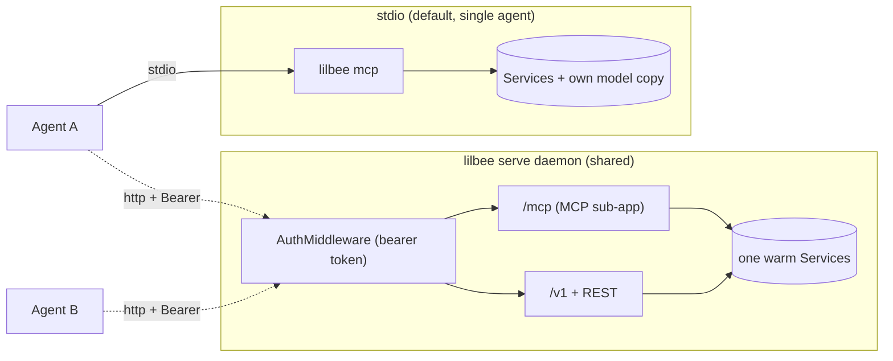

# Interface internals

The CLI, TUI, REST API, MCP server and Python library, and the auth model. For the overview, see [Architecture](../architecture.md).

## Interfaces

### CLI
- `lilbee ask "question"`: one-shot RAG answer with sources
- `lilbee chat`: launches the full Textual TUI (also `lilbee` with no args)
- `lilbee search "query"`: vector search, no LLM generation
- `lilbee sync` / `lilbee add` / `lilbee remove`: document management
- `lilbee model pull <name>` / `model list` / `model rm`: native GGUF model management
- `lilbee model use <chat|rerank|vision> <ref>`: set a role's model with the checks the `PUT /api/models` routes apply (the embedding model has `lilbee use-embedder`)
- `lilbee wiki build` / `wiki list` / `wiki read` / `wiki citations` / `wiki lint` / `wiki synthesize` / `wiki drafts` / `wiki prune` / `wiki wipe`: wiki layer
- `lilbee serve`: start the REST API server
- `lilbee mcp`: launch the MCP server
- `lilbee launch <client>` (e.g. `opencode`; pi gets lilbee's pi extension and skill by `-e` and `--skill`, with the server URL and token in its env): spawn the local server, install the lilbee skill, pass the provider + MCP wiring and the startup-model pin to the client per session (inline env config; the session's port and token are ephemeral, so nothing is persisted into the client's own config), exec the client, clean up on exit
- `lilbee agent-config <client>` (`claude`, `hermes`, `opencode`, `litellm`): print the client config block for hand-wired persistent setups
- `--json` / `-j` on any command for structured output

### TUI (Textual)
Launched by `lilbee` or `lilbee chat`. Screens: chat, task center, model catalog, settings, wiki, wiki-drafts review, status. Slash commands route through `src/lilbee/cli/tui/command_registry.py` (single source of truth). Every background job (sync, crawl, wiki build, model pull) runs in the app-level `TaskBarController` and is cancellable with `/cancel`.

### REST API (Litestar)
- OpenAI-compatible: `GET /v1/models`, `POST /v1/chat/completions` (streaming + tools). Errors use the OpenAI envelope with the codes in `src/lilbee/server/chat_completions_api/errors.py::CompletionsErrorCode` (`invalid_request`, `model_not_found`, `model_does_not_support_tools`, `context_length_exceeded`, `invalid_api_key`, `rate_limit_exceeded`, `internal_error`, `engine_missing`). The active model's `/v1/models` entry carries the granted engine shape (`context_window`, `slots`); a `reasoning` request field (`separate`/`inline`/`off`, default from the `completions_reasoning` setting) picks how thinking is presented. The usage block reports prompt tokens the engine served from its cache under `prompt_tokens_details.cached_tokens`, a subset of `prompt_tokens`.
- Anthropic-compatible: `POST /v1/messages` (streaming + tools), the route Claude Code talks to. Errors reuse the completions codes in the Anthropic envelope. The `thinking` request parameter (`{"type": "disabled"}` / `{"type": "enabled"}`) turns reasoning off or on for one call, over the `messages_reasoning` setting (`separate`/`inline`/`off`) that picks how thinking is presented. Its `budget_tokens` tightens the reasoning cap for that call, and must be 1024 or more to match Anthropic's minimum. The usage block reports prompt tokens the engine served from its cache under `cache_read_input_tokens`; as Anthropic defines them, `input_tokens`, `cache_creation_input_tokens` and `cache_read_input_tokens` are disjoint and sum to the prompt, and the creation count is always zero because the engine has no paid cache write. The streamed opener carries those keys with zero counts, because the engine reports usage only when the stream ends.
- Images and models by path: the two `/v1` chat routes drop image parts, answer from the text, and report the count in the `X-Lilbee-Images-Dropped` response header and the cause in the `X-Lilbee-Images-Dropped-Reason` header, with one warning in the server log. This holds for every model, because chat does not load the vision projector; use the vision role to read images. No chat model reports the `vision` capability. A request with images and no other content is a 400. A chat model configured as the absolute path of a GGUF file resolves in both routes the way the fleet loads it, and `/v1/models` lists it.
- Token counting: `POST /v1/messages/count_tokens` answers `{"input_tokens": N}` for the `/v1/messages` body minus the sampling fields. The system prompt, the conversation and the tool schemas go to the chat server as the body a chat call would send; its `/apply-template` renders the prompt and its `/tokenize` counts the render, so the number includes the template's role markers and tool-call preamble. Counting runs no tool, so the route skips the tool-capability check `/v1/messages` runs. It is not free of generation: the first count against a fresh replica sends the one-token exchange that probes for consecutive same-role turns, and a count that finds the chat model cold loads it. A backend that renders no prompt locally — a cloud SDK backend, or a local engine whose build carries no render route — gets an estimate instead: the request's own text in UTF-8 bytes, plus four fixed allowances for the template text the request does not carry (the preamble, the role markers per wire message, the tool-calling instructions, and the wrapper around each tool schema). A message returning several tool results becomes several wire messages, so the per-message allowance follows that count. The allowances come from a survey of 47 chat templates across 51 repositories, taken 2026-09-18; four templates exceed one, so the estimate can read low as well as high, and raising a constant only moves which template breaks it. Every answer carries the `X-Lilbee-Token-Count-Accuracy` response header, `exact` when the backend measured the number and `estimated` when it did not, so a client can tell the two apart while the body keeps the one field Anthropic documents.
- Both chat APIs bound thinking with `max_reasoning_chars` through `src/lilbee/server/chat_dispatch/reasoning_cap.py`. On a streaming call the wrapper closes the upstream stream when reasoning passes the cap, writes the cap notice into the open thinking block, and splices in a continuation asking the model to answer directly; the continuation is not capped again. On a non-streaming call the provider returns one finished result, so the wrapper re-issues only when the capped turn produced no answer.
- Search: `GET /api/search`, `POST /api/ask`, `POST /api/chat`, `POST /api/ask/stream`, `POST /api/chat/stream` (SSE)
- Documents: `GET /api/documents`, `POST /api/documents/remove`, `POST /api/add`, `POST /api/sync`, `GET /api/source` (vault-aware source retrieval)
- Models: `GET /api/models`, `GET /api/models/catalog`, `GET /api/models/installed`, `PUT /api/models/{chat,embedding,vision,reranker}`, `POST /api/models/pull`, `DELETE /api/models/{model}`
- Crawl: `POST /api/crawl` (SSE progress)
- Wiki: `GET /api/wiki`, `GET /api/wiki/{slug}`, `GET /api/wiki/{slug}/citations`, `GET /api/wiki/citations?source=`, `GET /api/wiki/status`, `POST /api/wiki/build` (add `?dry_run=true` for the JSON entity preview), `PATCH /api/wiki/update`, `POST /api/wiki/synthesize`, `POST /api/wiki/generate/{slug}` (these four are SSE streams; generate's done event carries the slug the read route accepts), `POST /api/wiki/lint`, `POST /api/wiki/prune`, `DELETE /api/wiki` (wipe; the one wiki route that answers while the wiki is disabled), `POST /api/wiki/index`, `GET /api/wiki/stubs` (the indexed pages nothing has written yet), `GET /api/wiki/drafts`, `GET /api/wiki/drafts/diff/{slug}`, `POST /api/wiki/drafts/accept/{slug}`, `DELETE /api/wiki/drafts/{slug}`
- Config: `GET /api/config`, `GET /api/config/defaults`, `GET /api/config/schema`, `GET /api/config/sources`, `PATCH /api/config`, `POST /api/config/reset`. The reset route takes `{"keys": [...]}` and removes each key from `config.toml`, so the value falls back to its `LILBEE_*` variable, the profile, or the built-in value; it answers `200` with the `PATCH` response shape and refuses the same keys `PATCH` refuses, plus a key whose fallback value its field rejects. `GET /api/config/defaults` answers the built-in value of each public setting, or the value the active profile sets. It ignores `LILBEE_*` variables, which a reset still falls back to first. `GET /api/config/sources` answers `{"sources": {"<key>": "<source>"}}` over the same keys as `GET /api/config`, where the source is `env`, `user`, `profile`, `built_in` or `auto`. The source `auto` marks a value that no layer supplies: a derived path, a model that a root inherits, or a value that a `config.toml` with a parse error leaves in place. `GET /api/config` keeps its flat shape. The schema route answers with one entry per public setting carrying `type`, `nullable`, `choices`, `writable`, `reindex_required`, `group`, `advanced` and `help`, so a client renders a picker for a closed value set instead of a text box. The entries come from the same settings boundary MCP `settings_list` reads, so a new setting appears without a route change.
- Profiles: `GET /api/profiles`, `GET /api/profiles/active`, `GET /api/profiles/{name}`, `GET /api/profiles/{name}/diff`, `GET /api/profiles/{name}/export` (a TOML download), `POST /api/profiles` (save as), `PUT /api/profiles/{name}` (update the active profile), `PATCH /api/profiles/{name}` (rename), `DELETE /api/profiles/{name}`, `POST /api/profiles/{name}/apply`, `POST /api/profiles/{name}/duplicate`, `POST /api/profiles/new`, `POST /api/profiles/discard`, `POST /api/profiles/import` and `POST /api/profiles/validate` (both take the file text and its file name). `GET /api/profiles/active` carries `changes`: each profile setting config.toml sets, with `key`, `yours`, `profile_value`, `profile_source` (where the value comes from without yours) and `effect`. `POST /api/profiles/discard` answers `dropped`, `reindex_required`, and `warnings` holding any notice the discard raises. It takes `?reindex=true` (default `false`, as `lilbee profile discard --reindex`): after the discard it rebuilds when a dropped value needs it, with the same SSE events, and its `done` event carries `rebuild` the same way. MCP `profile_manage` takes `reindex` for the `discard` action and returns the same `rebuild` and `rebuild_error` fields. `POST /api/profiles/{name}/apply` takes `?reindex=true` (default `false`, as `lilbee profile apply --reindex`): after the apply it rebuilds when the profile sets a setting that needs it or a file is held out, and answers with the `/api/sync` SSE events, `sync_wait` included while another sync holds the turn. Its `done` event carries the apply response plus `rebuild`, the sync result or null when no rebuild was needed. MCP `profile_apply` takes the same `reindex` and returns the same `rebuild` field, plus `rebuild_error` for a refused rebuild. A name in the URL only reaches the profile lookup, never a file path; a missing profile answers `404`, a name clash `409`, and any other refused operation `400`, with the same message the CLI and MCP print. A profile cannot take the name of a fixed route under `/api/profiles/` (`active`, `new`, `discard`, `import`, `validate`) or a Windows device name (`CON`, `NUL`, `COM1` and the like), in any spelling; a file on disk with such a name is listed as broken. Import and validate refuse a file over 256 KB, the same cap the file reader applies.
- Analyze: `POST /api/analyze` takes `{"directory", "apply", "save", "target"}` (all optional) and streams `analyze` progress events (`done`, `total`, `file`), then `done` with the report `lilbee --json analyze` prints, or `error`. A `directory` is an absolute folder on the server, inside or outside the project; a relative one, a missing folder, or a `target` without `apply` or `save` answers `400` before any file is read. A client that disconnects before the save starts cancels the run, and nothing is saved or recorded. `GET /api/analyze/state` and `POST /api/analyze/dismiss` answer `{"analyzed", "tip_dismissed", "tip_shows"}`; dismiss hides the tip first.
- Agent configs: `GET /api/agent-config` (supported clients plus whether each CLI is installed here), `GET /api/agent-config/{client}` (that client's config block, carrying this server's URL and current token)
- Status/health: `GET /api/status`, `GET /api/health`
- Interactive docs at `/schema/redoc`; OpenAPI JSON at `/schema/openapi.json`. Every release also attaches the same schema as an `openapi.json` asset, so a client can pin the contract for a version without running the server. A multi-segment path param such as the wiki `{slug:path}` carries `format: path`, because OpenAPI writes it as `{slug}`, the same as a one-segment param. Each profile route lists the errors it answers: `404` for a missing profile, `409` for a name clash, `400` for a refusal, and `503` when a profile file cannot be read or written. Streaming routes declare `text/event-stream` on the decorator, which is where litestar reads the documented content type from.

All chat-generating endpoints (`/api/ask`, `/api/chat`, both their `/stream` variants, and `POST /v1/chat/completions`) share a process-wide chat lock so only one inference call runs at a time per server. Concurrent requests queue server-side; if the wait exceeds the configured timeout the request returns 429 with a `Retry-After: 1` header.

### Auth model

All network surfaces, the `/v1/*` model runtime, the `/api/*` REST routes, and the `/mcp` streamable-http endpoint, share **one** bearer session token. The daemon generates it on startup, persists it to `server.json` (mode `0600`), and hands it to local clients through `lilbee agent-config`, `GET /api/agent-config/{client}`, and `lilbee launch`. Clients send `Authorization: Bearer <token>`; `AuthMiddleware` (`src/lilbee/server/auth.py`) checks it on **every** request, reads included. There is no unauthenticated route, `GET /api/health` included: health reports the chat engine's last error, which carries model paths and loader failures, so an open liveness probe would hand out the most useful reconnaissance on the box. A local probe runs as the user and reads the token out of `server.json` like every other local client.

`/v1/models` and `/v1/chat/completions` are the only routes the middleware skips, and they are not exempt: they check the same token inside the handler so a bad one comes back in the OpenAI error envelope rather than Litestar's 401 shape. `tests/server/test_every_route_is_authenticated.py` walks the live route table and asserts every path answers 401 without a token, so a new route cannot quietly opt out.

This is deliberately a single, unscoped token rather than a per-client or per-scope system. lilbee is a local-first, single-user tool: the daemon binds localhost only (with DNS-rebinding protection), and any process running as the user can read `server.json` regardless, so a per-agent token would not add a boundary that the filesystem doesn't already remove. The token exists to keep out other local users and drive-by browser requests, not to isolate the user's own agents from each other.

That purpose is why reads are gated too. Reads used to be open on the reasoning that they only exposed local state, but `server.json` is `0600` precisely so another local user cannot act as the daemon, and leaving `GET /api/export` open handed that same user the entire corpus without it. The boundary only means something if it covers the data.

The tradeoff is that the token is all-or-nothing: a client trusted with retrieval also gets generation and the mutating tools (`reset`, `remove`, `model_rm`, `settings_set`). That is acceptable for the user's own agents on localhost. Giving retrieval-only access to a less-trusted client would require a scoped token, which lilbee does not have today.

### MCP Server
- Search + lifecycle: `search(query, top_k, scope)`, `status`, `sync`, `add`, `crawl`, `crawl_status`, `init`, `remove`, `list_documents`, `reset`
- Models: `model_list`, `model_show`, `model_pull`, `model_rm`
- Wiki: `wiki_list`, `wiki_read`, `wiki_status`, `wiki_build`, `wiki_update`, `wiki_synthesize`, `wiki_lint`, `wiki_citations`, `wiki_drafts_list`, `wiki_drafts_diff`, `wiki_prune`, `wiki_index`, `wiki_generate`, `wiki_wipe` (needs `confirm=true`, and stays registered while the wiki is disabled). Accepting or rejecting a draft is deliberately absent from MCP: that call is a human review decision, so it stays on the CLI, the TUI, and the authenticated HTTP API.

#### Transports

The same MCP tool server is reachable two ways:

- **stdio** (`lilbee mcp`): the default for a single agent. The client spawns
  the process, which loads its own in-process `Services` (its own model copy).
  Zero configuration, no network.
- **streamable-http** (on the `lilbee serve` daemon): for multiple agents
  sharing one warm backend. The tool server mounts as a Litestar sub-app at
  `/mcp`, behind the same bearer-token `AuthMiddleware` as `/v1/*` and REST, and
  resolves the same process-wide `Services`. Sync tool handlers are offloaded
  off the event loop so one slow call cannot stall the other connected agents.
  Retrieval reads run concurrently; generation shares the chat lock above.



#### Schema-size discipline

The OpenAI tools schema ships on every chat request; bloat there taxes
every turn. lilbee's default surface is ~5.7 KB of raw JSON across 17
tools (~10% of a 32K context, ~35% of Gemma 4's 7K).

- Wiki tools and crawler tools are gated off the schema unless
  `cfg.wiki` is on or `lilbee[crawler]` is installed.
- Tool docstrings stay at one or two sentences (the SDK turns them
  into per-parameter schema descriptions).
- `LilbeeMCP.list_tools` in `mcp_server.py` drops the SDK/Pydantic
  auto-generated `title` keys before the tools hit the wire.
- `tests/test_mcp.py::TestToolsSchemaSize` caps the schema at 7 KB; new
  tools or doc bloat trip the cap and force a deliberate review.

### Python library
```python
from lilbee import Lilbee

bee = Lilbee("./docs")
bee.sync()
results = bee.search("authentication")
page = bee.documents(limit=50, offset=0)  # one page of indexed documents
report = bee.search_report("authentication")  # report.rows, report.degraded
```
`bee.search()` returns the rows. `bee.search_report()` returns the same rows and `degraded`, the warnings for each search step that failed (for example `rerank_failed`). REST, MCP and the CLI show the same warnings.
`bee.status()` returns the real `document_count` and the newest 10 source names. `bee.documents()` pages the listing that `GET /api/documents` pages, with the same default and bounds (limit 1 to 1000, default 50).

`Lilbee` composes the same `Store`, `Embedder`, `Searcher`, `Reranker`, and `ConceptGraph` the CLI and server use.
