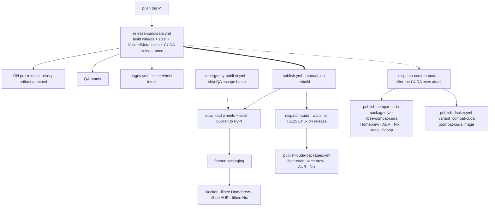
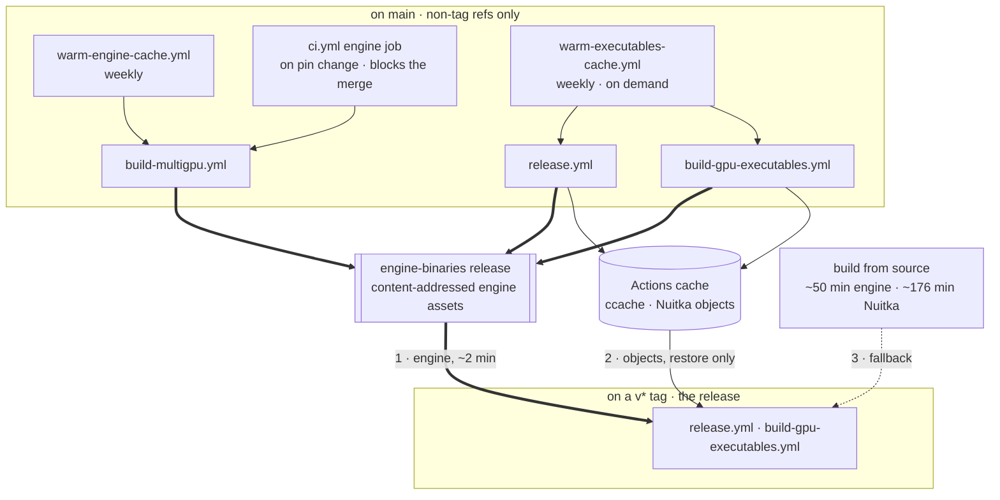

# Release pipeline

How a release is built and where each build's inputs come from. For the overview, see [Architecture](../architecture.md).

## Release pipeline

Releases are **build-once, publish-later**. Pushing a `v*` tag builds every shippable artifact one time inside a single workflow run; QA installs *those* artifacts; publishing is a separate manual step that only downloads and uploads what that run already built. Nothing is rebuilt downstream. The PyPI publish needs only the default wheels + sdist (they finish ~25 min into the run), so it doesn't wait on the executables, the CUDA matrix, or QA — only the downstream packaging fan-out (which consumes the executables on the GH release) waits for those.

Thick arrow = the publish path; dotted = triggered/side paths. Timings, what-waits-on-what, and the fan-out's self-skip are in the notes below.

### Lanes

| Lane | Trigger | Builds | QA | Publishes |
|---|---|---|---|---|
| **Release candidate** | `git push v0.6.66bN` | default wheels, sdist, extra (CUDA) wheels, Vulkan/Metal executables, CUDA executables — once, all in parallel | yes | no (artifacts only); attaches everything to a GH **pre-release** |
| **Publish to PyPI** | `gh workflow run publish.yml -f tag=v0.6.66bN` | nothing — downloads the RC run's artifacts | n/a — needs only the default wheels (no wait on executables/CUDA/QA) | PyPI, then in parallel: Docker / lilbee Homebrew / AUR / Nix via `fanout-packaging`, and `lilbee-cuda` Homebrew / AUR / Nix via `dispatch-cuda` → `publish-cuda-packages.yml` |
| **Emergency publish** | `gh workflow run emergency-publish.yml -f tag=... -f confirm=skip-qa` | nothing — downloads the RC run's artifacts | skipped on purpose | same as Publish to PyPI; tolerates an incomplete artifact set |
| **Promote** | `make promote FROM=v0.6.90b420.dev719 TO=0.6.90b420` | everything — the version is baked into the artifacts, so a new version is necessarily a new build | full RC gates again | a **separate, new release** of the same source under the new version, with the FROM release's notes carried over; the FROM release is never modified |

`release-candidate.yml` can also be dispatched manually against a branch/SHA — same build + QA, no pre-release attach, never publishes. That's a dry run.

`build-gpu-executables.yml` is also dispatchable standalone (`gh workflow run build-gpu-executables.yml -f tag=v...`) to backfill CUDA binaries onto a historical release; in that mode each cell attaches directly to the named release tag instead of relying on `attach-prerelease`.

### Where a build's inputs come from

A release is dominated by two things it should almost never do: compiling `llama-server` (~50 min per leg) and compiling ~9056 C files with Nuitka (~176 min on Windows). Both are pure functions of pinned inputs, so both are fetched rather than rebuilt.

Thick arrow = the fast path. Engines resolve mirror, then Actions cache, then source build, so a missing asset degrades to the old timing rather than failing.

Two properties do the work:

**Tag runs read, they never write.** GitHub scopes a cache save to the creating ref, and a tag is its own scope, so anything a release saved was unreadable by every later run while still evicting the main-scoped entry that would have hit. Every save is now guarded on `github.ref_type != 'tag'`; the warm workflows on main are what populate.

**Engines live on a release, not in the cache.** The Actions cache has a hard 10 GiB per-repo cap with LRU eviction and drops anything unaccessed for 7 days. Engine binaries are ~3.5 GiB of that and are perfectly immutable (every source pinned in `engine-versions.env`), so they sit on the `engine-binaries` release instead, keyed by the same hash the cache key uses.

A built engine is written to the mirror and nowhere else. Storing it in the Actions cache too would spend the cap duplicating what the mirror already holds durably, and that cap is exactly what the Nuitka object caches need: object caches want per-file granularity and must be a cache, engines are a single immutable blob and need not be. Restores still fall through mirror, then cache, then a source build, so engines cached before the mirror existed are still read. `asset_name()` in `tools/wheel-build/ci_mirror.sh` maps key to asset name for both the reader and the writer, because a mismatch there would not fail, it would silently never hit. Fetched with `curl`, not `gh`: the manylinux container the Linux legs build in ships no `gh`.

The Nuitka object cache is keyed on the dependency set, so the key does not move when only lilbee code changes. To stop the blob from freezing, the mirror adds a 30-day age bucket to that key (`MIRROR_REFRESH_DAYS`, input `refresh-days` of the `nuitka-object-cache` action). A publish writes the current bucket. A restore reads the current bucket, then the one before it, so the first build of a new bucket starts warm. The action reports `restored` (any bucket served) and `current` (the current bucket served). The Windows workflows publish when `current` is not `true`, so the first build of a new bucket writes the refreshed blob. No blob is older than two buckets. The action rejects a `refresh-days` that is not a whole number of 1 or more in its first step, which fails the build. Superseded blobs stay on the release until someone deletes them.

**Nothing here can change a shipped binary.** Every mechanism either serves bytes that are already identical or misses:

- ccache and clcache key each entry on the preprocessed source plus the compiler and its flags, so a hit is by definition the same object file and a mismatch misses. ccache's correctness sloppiness is left at its conservative default, so translation units using `__DATE__` / `__TIME__` are not cached at all.
- The engine key covers every input `build_llama_server.sh` reads: backend, toolkit version, the llama.cpp pin, the three pins in `engine-versions.env`, and the build scripts themselves. The remaining variables are parallelism (`ENGINE_BUILD_JOBS`), a scratch path (`LLAMA_BUILD_DIR`), and `TARGET_ARCH`, which CI never sets.
- `cache-env` carries the runner image or container, which is what fixes the glibc floor. A repointed runner label changes the key and forces a rebuild.
- Mirror assets never expire, unlike cache entries. That is benign for engines: they are self-contained with a baked rpath, and an engine built on an older image of the same label carries a lower glibc floor, not a higher one.

One optimisation was tried and rejected for exactly this reason. Gating the CUDA toolkit install on a mirror probe would have saved 4.9 min, but the probe and the fetch are separate requests, and a cell that skips the toolkit and then has to build the engine fails with no `CUDA_PATH`; since these cells are `continue-on-error`, that ships a release missing a CUDA binary rather than failing it.

### Notes

- **Single build location.** The lilbee wheel (pure Python), sdist, the per-backend `lilbee-engine-llama-cpp` wheels, and every executable (Vulkan, Metal, CUDA) are produced only by the `release-candidate.yml` run for the tag. `build-default-wheels.yml` builds the lilbee wheel + sdist, `build-multigpu.yml` builds the engine wheels, `release.yml` the Vulkan/Metal exes, `build-gpu-executables.yml` the CUDA exes. `publish.yml` / `emergency-publish.yml` resolve that run by commit SHA and pull its artifacts; they never invoke a builder. The engine wheels and CUDA executable cells are `continue-on-error` so a slow GPU cell never holds up anything.
- **PyPI publishes early; the fan-out waits.** `publish.yml` gates on the lilbee wheel + sdist being complete in the RC run, then uploads both. The engine wheels never go to PyPI: a plain `pip install lilbee` has no engine, and `lilbee engine install` downloads one. The Homebrew/AUR/Nix/Docker fan-out for the default `lilbee` package pins the executables by hash, so `fanout-packaging` self-skips (with a warning) until those assets are attached to the GH release; re-running `publish.yml` then completes the fan-out. The PyPI upload is `skip-existing`, so re-running is safe.
- **CUDA fan-out is its own lane.** `publish.yml`'s `dispatch-cuda` job runs in parallel with `publish-pypi` (it needs `guard` only, not the PyPI upload), polls the release for `lilbee-linux-x86_64-cu125`, and dispatches `publish-cuda-packages.yml` as soon as that asset attaches. That workflow updates the `lilbee-cuda` Homebrew formula, the `lilbee-cuda` AUR package, and the `sources-cuda.json` flake entry. Vulkan and CUDA fan-outs are fully decoupled: a slow Windows CUDA cell can't stall the `lilbee` Homebrew update, and a PyPI hiccup can't stall the `lilbee-cuda` update.
- **`sources-cuda.json` is the CUDA flake state.** `publish-packages.yml` rewrites `sources.json` from scratch on every release (the Vulkan/Metal entries); the CUDA flake entry lives in a separate `sources-cuda.json` so the Vulkan publish can't wipe it. `flake.nix` reads both files; the `lilbee-cuda` package output only appears when `sources-cuda.json` lists a system. `flake-check.yml` triggers on either file.
- **Compat CUDA is its own fan-out.** `lilbee-compat-cuda` ships the pre-Haswell cu124 binary (`lilbee-compat-linux-x86_64-cu124`, and `lilbee-compat-windows-x86_64-cu124.exe` for Scoop). `release-candidate.yml`'s `dispatch-compat-cuda` job runs after the CUDA build and dispatches `publish-compat-cuda-packages.yml` (Homebrew, AUR, Nix, snap, Scoop) and the `compat-cuda` Docker image. Flatpak is one more entry of `publish-flatpak.yml`. The fan-out's `resolve` job asserts nothing: each channel job fails only for the binary it ships, so a failure here never blocks another variant. The flake state lives in `sources-compat-cuda.json`, which `flake.nix` reads at evaluation, so the seed file must stay committed. `flake-check.yml` and the `ci.yml` flake group list it.
- **GPU build cells live in `.github/gpu-cells.yml`.** `build-gpu-executables.yml` has a `plan` job that reads the file and hands the cells to `build` as its matrix. The `only_asset` input on both triggers narrows a run to one cell, and the default (empty) builds every cell. A dispatch with a `tag` attaches each cell it builds to that release and replaces the asset, so back-filling one binary on a released tag needs `only_asset`: a full rebuild changes assets that channels pin by hash. `plan` checks out the workflow's own ref, never the `tag` input, so a back-fill at an old tag still reads the current cells file. A cell with `soft: true` is droppable: `verify-release.yml` and the Flatpak `resolve` step read the flag from this file and do not require that binary or the channel files built from it.
- **Back-filling one channel for a released tag.** `publish-flatpak.yml` takes `only_app` (one app id) and `publish-docker.yml` takes `variant` (`default`, `cuda`, `rocm` or `compat-cuda`); an empty value keeps today's behavior. The `compat-cuda` image builds only when asked by name, because the default run starts before the CUDA build attaches its binary.
- **`lilbee` and `lilbee-cuda` are separate Homebrew / AUR / Nix packages.** Both ship a `lilbee` binary; the formula and `PKGBUILD` declare `conflicts_with` / `provides` so users swap between them. The Nix flake exposes them as parallel package outputs (`#default` vs `#lilbee-cuda`).
- **Promotion is a same-source re-release, not a mutation.** `make promote FROM=<tag> TO=<version>` (`scripts/promote_release.sh`) puts a commit with the subject `Promote <version>` on top of the FROM tag's commit that changes only the version in `pyproject.toml`, `uv.lock` and the Claude plugin manifest (`plugins/lilbee/.claude-plugin/plugin.json`), tags it, and pushes just the tag — `main` and the FROM release stay untouched, so releases are immutable and anyone pinned to the old one is unaffected. The rebuild is unavoidable (the version is baked into `--version`, the wheel metadata, and every manifest), but same-source is guaranteed: `release-candidate.yml` classifies a tag as a promotion when its parent commit is itself a `v*` tag, its subject starts with `Promote `, and the diff touches only those three version files — read from the git graph and the diff, not declared by a flag; the subject tells it apart from a back-to-back release, which changes the same files — and creates the new release with the FROM release's notes under a "Promoted from" banner. `attach-prerelease` skips note regeneration for promoted tags and `make release-promote` keeps the copied notes when marking one latest.
- **Executable caches are warmed on main.** GitHub cache saves are scoped to the creating ref, so tag runs can never save a cache a later run restores — cold, that's ~2h Linux, ~1h15 macOS, ~4h Windows per release. `warm-executables-cache.yml` (weekly + on demand) runs both `release.yml` and `build-gpu-executables.yml` on main so tag runs restore warm ccache (Linux/macOS) and Nuitka caches (Windows, `NUITKA_CACHE_DIR`) instead. Dispatch it before a promotion: a promoted tag compiles identical source, so the build should hit nearly everything.
- **`CCACHE_DIR` has to be exported, not configured.** `hendrikmuhs/ccache-action` sets ccache's cache directory through its config file, but Nuitka exports its own `CCACHE_DIR` unless one is already set (`nuitka/build/SconsCaching.py`), and the env var outranks the config. Without the explicit export, Nuitka's objects land in a runner-local directory and every release compiles cold while `ccache -s` truthfully reports zero hits on zero lookups.
- **Cache keys carry the compile flags.** The compat cells build at `-march=x86-64-v2`; sharing a ccache key with the stock cells poisoned both. Keys include `march` where it differs. The two Windows cells compile the same C and deliberately share a restore prefix.
- **Pull requests build one executable.** `executable-check.yml` calls `release.yml` with `only_asset` when a pull request changes `pyproject.toml`, `uv.lock` or the build tooling, so a dependency that breaks the Nuitka build fails there and not at release. The Linux cell always runs; the Windows cell runs only when `tools/wheel-build/**` or the cell list changes. A narrowed run skips lint and test, and publishes nothing: no engine mirror upload, no Nuitka cache mirror upload, no release attach. The engine mirror is not read either, so an engine missing from the Actions cache builds from source. The Nuitka version is pinned exactly at every install site, so a new Nuitka release arrives as a pull request that this check builds. Dispatch `release.yml` with `only_asset` to build any one cell by hand.
- **Playwright's generated API modules are bytecode in the executables.** `playwright.async_api._generated` and its sync twin are 23,000 lines each, and Nuitka turns each into a C file of about 480,000 lines (19 MB). The 32-bit MSVC compiler stops on it with C1002 ("out of heap space in pass 2"), and Nuitka 4.3 writes a file about 4% larger than 4.2.2, enough to cross the limit on Windows. `tools/wheel-build/playwright_generated_bytecode.py` makes Nuitka include both modules as bytecode, so MSVC never sees them. The wrappers only forward calls to the implementation modules, which stay compiled.
- **Executable build skips redundant CI.** `release.yml` has a `gate` job that checks whether the `CI` workflow already went green on the same commit (every `main` push runs it). If so it skips the lint + test re-run and goes straight to Nuitka; if not (or if anything is uncertain) it runs them. `skip_tests: true` lets you build past a known-flaky test after eyeballing the failure; lint always gates. `build-gpu-executables.yml` has no such gate (CI cost there is dominated by the CUDA-toolkit install + Nuitka build itself, not the test re-run).
- **Package versions auto-increment.** `publish-docker.yml`, `publish-packages.yml`, and `publish-cuda-packages.yml` derive the version from the `-f tag=` input (`version = ${tag#v}`), so Docker tags, the Homebrew formulas, the AUR `PKGBUILD`s, and the Nix flake all bump to the new version on their own — no manual edits.
- **PyPI Trusted Publishing is pinned to filenames.** PyPI's trusted-publisher config keys on the `publish.yml` workflow filename and the `pypi` GitHub environment name. Don't rename either.
- **The engine ships as the `lilbee-engine-llama-cpp` wheel.** `build-multigpu.yml` builds a self-contained `llama-server` (binary + ggml/llama/mtmd libs, rpath-baked) per backend via `tools/wheel-build/build_llama_server.sh`, plus the `llama-swap` supervisor/proxy and the `gguf-parser` VRAM estimator (static Go binaries built from pinned source in the same script). The wheels go to the per-backend PEP 503 index (`lilbee.sh/<backend>/`), never to PyPI. A `pip` or `uv` install of `lilbee` has no engine extra; it downloads an engine pack with `lilbee engine install`. The standalone executables bundle the same self-contained engine via Nuitka, so brew / Docker / AUR carry it too. The llama.cpp source tag and the llama-swap / gguf-parser source tags are pinned in `engine-versions.env`. The llama-swap router also installs on its own, from the upstream release of the same pinned version (`router_install.py`: asset name, size and sha256 per OS and CPU, kept in `<engines>/router/<version>/` with the MIT notice), so an install of another engine without the llama.cpp pack can start. The lookup order is the bundled wheel, the installed router, the llama.cpp pack copy, then PATH. The pack copy stays until the pack build drops it.
