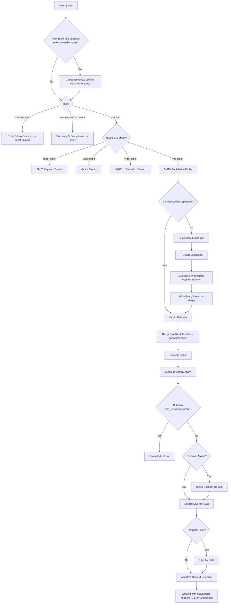

# Search internals

Every stage of the search pipeline and the techniques behind it. For the overview, see [Architecture](../architecture.md).

## Search Pipeline

This is the core of lilbee's retrieval quality. Questions are routed by shape before retrieval runs, every result carries one canonical relevance score, and expensive operations are skipped when simpler ones produce confident results.



### Technique Reference

#### Intent Routing
**On by default** (`LILBEE_INTENT_ROUTING`). Three question shapes reach retrieval, and only one of them is a similarity problem, so questions are routed before top-k search runs. Detection is deterministic and conservative: anything unrecognized takes the topical path unchanged.

- **Known-item**: a question naming a document (a filename, a quoted title, "document 482") resolves the reference against source metadata; a reference matching exactly one source returns that document's chunks in document order at full confidence. Similarity search retrieves neighbors of the question's *wording*, which for "summarize survey_482.pdf" is mostly noise.
- **Aggregate**: "how many documents mention X" runs an exact scan over every chunk (streamed Arrow batches, flat memory) and answers with real numbers, no LLM involved. A count is a corpus property; the top 20 of half a million chunks structurally cannot count anything, and the model's only honest move was to hedge. Counts that need typed records the store does not hold are declined with a precise statement of what is countable.
- Every answering surface consults the same router (`Searcher.route_direct_answer`): CLI and TUI via ask, and each HTTP handler directly. Known-item resolution also runs on bare retrieval (`Searcher.search`, so HTTP `/api/search` and MCP search), where a document-naming query returns that document's head in document order instead of similarity neighbors of its wording.

#### History Condensation
**Off by default** (`LILBEE_HISTORY_REWRITE`). When on, a follow-up that refers to earlier turns is condensed into a standalone retrieval query using the recent chat history (one small LLM call). A question that stands alone is searched as typed: the gate is a deterministic language-pack pattern (a follow-up opener such as "and" or "what about", a pronoun or reference word, or fewer than three tokens). Retrieval sees only the query text: without the rewrite, "what about his brother?" is embedded and BM25-matched with its pronouns. The rewrite is model output and varies between calls, which is why it is opt-in. The user's original wording still reaches the answering prompt. The rewrite travels with the answer. `/api/ask` and `/api/chat` return it as `retrieval_query`, and both SSE streams emit a `retrieval_query` event before the first token. `Searcher.ask_stream` yields a `RetrievalNotice` before the first token, which the CLI prints as a "Searching for" line on stderr and the TUI shows in the answer bubble's status row.

#### Hybrid Search (Weighted Reciprocal-Rank Fusion)
**Always on.** Retrieves a vector arm and a BM25 chunk arm (LanceDB FTS) independently, each fetched exactly `top_k` deep, then fuses by weighted reciprocal rank into one [0, 1] score. An optional third BM25 arm over document titles joins when `LILBEE_TITLE_SEARCH` is on:

```
score = Σ_arm weight_arm × rank_weight(rank_arm) / Σ_arm weight_arm,  rank_weight(r) = 61 / (60 + r)
```

The vector arm weighs 1.0, the lexical arm `LILBEE_LEXICAL_FUSION_WEIGHT`, the title arm `LILBEE_TITLE_SEARCH_WEIGHT`. A row ranked first by every arm scores 1.0; a row only one arm retrieved scores that arm's share of the total weight, so a peaked single-arm hit stays visible next to rows deep in the other arms. The fused ordering is final: no diversity selection runs on the hybrid path.

- **Adaptive fusion** (`LILBEE_ADAPTIVE_FUSION`, off by default pending eval): the lexical arms' weight is scaled per query by how peaked the vector ranking is, so a confident dense arm quiets lexical and a flat one keeps it. `LILBEE_LEXICAL_FUSION_WEIGHT` is the ceiling the rule scales down from. The confidence margin reads a fixed window of runners-up (so retrieval depth cannot change it) and the scale floors above zero, so BM25 provenance and the distance-cut exemption survive even a fully confident vector arm.
- **Why rank fusion and not score fusion**: a convex combination of normalized raw scores (`alpha × vector_similarity + (1 − alpha) × normalized_bm25`) was tried here and regressed graded precision about 20% against RRF, at every blend weight. Cosine similarities sit in a high narrow band, giving every dense neighbor a score floor that crowds out lexically-certain rows; ranks are scale-free, so neither arm's score distribution can drown the other. (On the rank-vs-score question, see Bruch et al. 2024, "[An Analysis of Fusion Functions for Hybrid Retrieval](https://dl.acm.org/doi/10.1145/3596512)".) Arm depth matters as much as the formula: rows both arms rank mid-pool accumulate two contributions, so deep candidate pools flood the fused top-k with both-arm mediocrity; arms therefore stay `top_k` deep.
- **Why no MMR on this path**: for lexical queries the relevant passages are often mutually similar (they quote the same identifiers), which is exactly what diversity selection penalizes; running MMR over the fused pool measurably traded relevant lexical hits for diverse off-topic neighbors. MMR still runs on the vector-only fallback path.
- **Canonical score**: every search path sets `SearchChunk.score`, and every downstream stage (sorting, filtering, greedy set cover, concept boost, reranker blending) compares only that field. `distance`, `bm25_score`, and the legacy `relevance_score` remain as provenance.
- **Abstention**: `min_relevance_score` gates on the fused [0, 1] score. The score normalizes against the weights of the arms in play for that query (the title arm counts only when it matched), so every query reports the fraction of its trusted rank support on one canonical scale and the threshold is a usable floor: when every retrieved chunk falls below it, ask refuses instead of feeding noise as context. Raw RRF sums (~0.016-0.033 total range) made any threshold meaningless.
- **max_distance** applies to rows whose *only* signal is a far vector match; a row the BM25 arm also matched keeps its standing regardless of distance, since dropping it would re-bury exactly the identifier hits fusion exists to preserve.
- **When it helps**: queries with specific terms, function names, error messages, exact phrases, document identifiers.

#### MMR Diversity
**Vector-only path.** Maximal Marginal Relevance prevents near-duplicate chunks from filling all result slots when search runs without a text query (or hybrid falls back). It does not run on hybrid results, where the fused ordering is final.

- **Paper**: Carbonell & Goldstein 1998, "[The Use of MMR, Diversity-Based Reranking](https://dl.acm.org/doi/10.1145/290941.291025)"
- **Default**: λ=0.5 (equal weight to relevance and diversity). This is the standard default from the original paper.
- **Tradeoff**: λ=1.0 gives pure relevance (may return 5 chunks from the same paragraph). λ=0.0 gives maximum diversity (may sacrifice the most relevant result for variety). 0.5 balances both.
- **When to tune**: increase λ for factual lookups ("what is the API key format?"), decrease for exploratory queries ("how does authentication work?").

#### Source Diversity
**Always on.** Caps results per source document so one large file doesn't dominate all top-k slots.

- **Paper**: Zhai 2008, "[Towards a Game-Theoretic Framework for Information Retrieval](https://dl.acm.org/doi/10.1007/978-3-540-78646-7_13)"
- **Default**: 5 chunks per source (`LILBEE_DIVERSITY_MAX_PER_SOURCE`).
- **Tradeoff**: lower cap = more diverse sources but may miss relevant sections from a single comprehensive document.

#### Query Expansion
**On by default, skipped when BM25 is already confident.** LLM generates 2-3 alternative phrasings of the query, each is searched independently, and results are merged via deduplication.

- **Technique**: standard multi-query retrieval
- **Cost**: 1 LLM call (~200 tokens) + N embedding calls per variant
- **Default**: 3 variants. Set `LILBEE_QUERY_EXPANSION_COUNT=0` to disable entirely.
- **When it helps**: queries using different terminology than the indexed documents. E.g. user asks "how to deploy" but the docs say "installation steps".

#### Confidence-Based Expansion Skip
**On by default.** Before running the expensive LLM expansion call, does a quick BM25 probe. If the top BM25 result is highly confident and clearly separated from the runner-up, expansion is skipped entirely.

- **Technique**: early termination based on BM25 score distribution
- **Default threshold**: 0.80 in saturating confidence space `s / (s + 5)`, which corresponds to a raw BM25 score of 20
- **Default gap**: 0.15 as the *relative* raw-score gap, `(top - second) / top`
- **Why not a sigmoid**: a plain sigmoid saturates at ~0.99 for any raw score above 5, so the gap between two strong scores compressed to under 0.01 and the skip condition was unsatisfiable exactly when the lexical arm was most certain. The saturating ratio keeps strong scores distinguishable and the relative gap compares where the information actually is, in raw score space.
- **Tradeoff**: higher threshold = expansion runs more often (better recall, more latency). Lower = expansion skipped more (faster, may miss some results).
- **Caveat**: these are starting defaults; calibrate for your corpus.

#### Expansion Guardrails
**On by default.** Validates LLM-generated query variants to prevent drift.

- **Technique**: cosine similarity between the question's embedding and each variant's embedding. Language-agnostic (works for any library the embedding model supports) and reuses the variant vectors that the multi-query search would have embedded anyway, so there are zero extra embed calls.
- **Threshold**: 0.5 by default via `LILBEE_EXPANSION_SIMILARITY_THRESHOLD`. Raise it to reject more variants (stricter); lower it to keep more (looser). Calibrate per embedding model. Dense 768-dim models cluster higher by default than contrastively-trained ones.
- **Concept-graph variants bypass this check**: they come from deterministic graph traversal and are expected to be partial phrases with lower similarity to the full question.
- **Tradeoff**: guardrails may filter out creative but valid variants. Disable via `LILBEE_EXPANSION_GUARDRAILS=false` if recall is more important than precision.

#### HyDE (Hypothetical Document Embeddings)
**Off by default.** Generates a hypothetical excerpt (50-100 words) that reads like a real document answering the query, embeds it, and searches with it alongside the original query vector. Reasoning-model output is stripped before embedding, so a think-block never stands in for the passage.

- **Paper**: Gao et al. 2022, "[Precise Zero-Shot Dense Retrieval without Relevance Labels](https://arxiv.org/abs/2212.10496)"
- **Cost**: 1 additional LLM call + 1 embedding (~500ms total)
- **Default weight**: 0.7, applied multiplicatively to the canonical score (hypothetical results are discounted because they're fabricated: they approximate the answer space but aren't based on real content; 1.0 trusts them as much as direct hits)
- **When it helps**: vague or short queries where the user's terminology doesn't match the indexed documents. E.g. "how does the thing work" where the "thing" is described with specific technical vocabulary in the docs.
- **When to skip**: factual lookups, keyword-heavy queries, or when latency matters.

#### Concept Graph (LazyGraphRAG Index Side)
**On by default.** At index time, extracts noun phrases from each chunk via spaCy, builds a co-occurrence graph weighted by Positive Pointwise Mutual Information (PPMI), and clusters concepts with the Leiden algorithm. Zero LLM calls at index or query time.

Two query-time effects:
- **Concept boost**: for each search result, counts concept overlap between the query's noun phrases and the chunk's concepts. The canonical score is raised by `overlap_ratio × concept_boost_weight` (default 0.3, clamped at 1.0), so the boost weight is directly comparable to a fusion arm's weight. Only promotes, never demotes.
- **Graph expansion**: traverses the co-occurrence graph (1 hop BFS) to find concepts related to the query. These supplement LLM-generated expansion variants and go through the same drift guardrails.

- **Inspiration**: Microsoft Research 2024-2025, "[LazyGraphRAG](https://www.microsoft.com/en-us/research/blog/lazygraphrag-setting-a-new-standard-for-quality-and-cost/)". NLP concept extraction at index time, defer reasoning to query time.
- **Clustering**: Traag et al. 2019, "[From Louvain to Leiden](https://www.nature.com/articles/s41598-019-41695-z)" via graspologic-native (Rust).
- **Weighting**: Church & Hanks 1990, PPMI: `max(0, log2(P(a,b) / P(a)P(b)))`. Negative values clamped to zero to discard anti-correlated concept pairs.
- **Cost**: ~10ms per chunk at index time (spaCy NLP). Zero additional cost at query time (table lookups only).
- **When it helps**: queries where related but not identical concepts appear across documents. E.g. "connection pooling" finding both database and API performance docs because both mention it alongside related concepts.
- **Browse**: `lilbee topics` shows concept communities, a map of what's in the index.

#### Cross-Encoder Reranking
**Off by default.** Requires a reranker model to be configured. After hybrid search returns candidates, a cross-encoder model scores each (query, chunk) pair for more precise relevance ranking.

- **Paper**: Nogueira & Cho 2019, "[Passage Re-ranking with BERT](https://arxiv.org/abs/1901.04085)"
- **Position-aware blending**: instead of replacing fusion scores entirely, rerank scores are blended with fusion scores using position-dependent weights:
  - Top 3 results: 70% fusion / 30% rerank (these were already ranked high by fusion for good reason)
  - Positions 4-10: 50% / 50% (equal influence)
  - Positions 11+: 30% fusion / 70% rerank (reranker has more opportunity to rescue misranked items)
- **Blending rationale**: derived from learning-to-rank literature (Burges et al. 2005, "[Learning to Rank using Gradient Descent](https://dl.acm.org/doi/10.1145/1102351.1102363)"). Top positions already have strong signal, so the reranker provides diminishing returns there.
- **BM25 protection**: if the rank-1 result has a BM25 score above the expansion skip threshold, it is protected from demotion. This prevents the neural reranker from pushing down obvious exact keyword matches.
- **Context selection**: reranked results carry their blended score (`rerank_score`) and the reranked order decides which chunks become LLM context, taking the top `max_context_sources` directly instead of the set-cover pass below.
- **Cost**: depends on model and candidate count. ~200-500ms for 20 candidates with a small cross-encoder.

#### Adaptive Distance Threshold
**Off by default.** When enabled, if the initial cosine distance filter returns too few results, the threshold is widened step by step until enough results are found or a safety cap is reached.

- **Controlled by**: `LILBEE_ADAPTIVE_THRESHOLD` (default: `false`)
- **Default step**: 0.2 (widens from initial `max_distance` in increments, configurable via `LILBEE_ADAPTIVE_THRESHOLD_STEP`)
- **Safety cap**: 20 iterations maximum to prevent runaway loops
- **When it helps**: novel queries or small indexes where strict distance thresholds would return empty results.

#### Adaptive Context Selection
**On by default.** After search results are ranked, selects which chunks to include as LLM context based on query term coverage rather than just taking the top-k, with each chunk's IDF gain weighted by its canonical score. When cross-encoder reranking is active, the reranked order is the more precise signal and replaces this pass.

- **Technique**: greedy set-cover approximation
- **Algorithm**: tokenize query into terms, greedily select chunks that add the most uncovered term weight, scaled by canonical relevance
- **Default max sources**: 8 chunks (`LILBEE_MAX_CONTEXT_SOURCES`)
- **When it helps**: multi-faceted queries like "compare X and Y" where top-k might only cover X but context selection ensures Y is also represented.

#### Typed Entity Extraction (opt-in ingest mode)
**Off by default** (`LILBEE_ENTITY_EXTRACTION`). Extracts typed entities into a
dedicated `entities` table so count and cross-reference questions get exact
answers from a scan instead of a hedge from top-k retrieval. Additive: the new
table changes no existing schema, requires no migration, and a store without
it behaves as if nothing was extracted.

Turning the setting on is the whole interaction; sync runs the lifecycle:

1. **Induction** (first sync after enabling, cheap): an LLM reads a
   stratified sample of the indexed chunks and proposes the corpus-specific
   type schema, persisted inside the index alongside the tables it governs.
   A general NER tag set has no notion of the identifier types a specific
   corpus carries. The schema is machine state: nothing to review, edit, or
   keep next to the database, and it travels with the index.
2. **Extraction** (same sync, then incrementally): each type is found by
   the cheapest extractor that serves it: compiled regex for
   identifier-shaped types, spaCy labels for people/organizations/dates
   (when the `graph` extra's model is available), and an LLM only for types
   neither can catch. The full pass reads chunk text from the store (no
   documents re-ingested, no embeddings recomputed) and always clears prior
   rows first, so an interrupted pass never double-counts. New files
   extract at ingest. If no chat model is available for induction, sync
   logs it and retries next time; nothing fails.
3. **Evolution** (later syncs): a library that grows a new kind of document
   would otherwise keep answering with the taxonomy induced on day one, so
   the schema row records how many documents the index held at induction,
   and once the corpus has grown materially past that (half again as many,
   or any growth at all while the corpus is tiny) sync re-induces from a
   fresh sample and unions in types the schema has never seen. A type is
   identified by what it *extracts*, not the name a model gave it, so a
   rename of a known pattern adds nothing. Re-induction that finds nothing
   new costs one sampled chat call, records the new size, and skips the
   extraction pass; one that adds a type re-extracts under replace
   semantics, so counts never double.

Query-time effects: "how many distinct X" answers with exact distinct counts,
and "how many X per Y" groups by chunk co-occurrence, both computed by full
scans over the entities table with no LLM in the loop. Count questions whose
nouns don't resolve against the schema decline precisely, naming the types
that are countable. Re-ingesting a source replaces its entity rows the same
way it replaces its chunks.

#### Context Provenance Headers
**Always on.** Each context block opens with a one-line header naming its source and page or line span (`[3] (survey_report.pdf, pages 3-4)`), so the answering model can attribute claims to a named document, notice two chunks share a source, and confirm it is reading the document the user asked about. Citation markers in answers are parsed as `[1]`, `[1, 2]`, and bounded ranges like `[1-3]`.

#### Temporal Filtering
**On by default, activates only when temporal keywords are detected in the query.**

- **Keywords detected**: "recent", "latest", "today", "yesterday", "this week", "last week", "this month", "last month"
- **Date source**: the creation date the extractor reports (preferred) or the ingestion time (fallback); a date with no zone is local time
- **Ranges**: day, week and month boundaries follow the time zone of the lilbee process (the `TZ` variable, else the OS zone); `recent` is the last 30 days
- **Behavior**: when active, retrieves 3x candidates (compensating for filtering loss) and sorts by recency
- **When it helps**: queries like "what changed recently?" or "latest notes about X"

#### Structured Query Modes
**Always available.** Power-user feature for direct control over the retrieval pipeline.

- `term: kubernetes pod scheduling`: BM25 keyword search only (no vector, no expansion)
- `vec: how does container orchestration work`: vector search only (no BM25)
- `hyde: explain the scheduling algorithm`: generate hypothetical document, embed, search
- No prefix → standard hybrid pipeline with all features

Useful for benchmarking (compare BM25 vs vector on the same question), debugging (why isn't this document in keyword results?), and precision (when you know exactly what you want).

#### ANN Vector Index (scaling)
**Threshold-gated.** Below `LILBEE_ANN_INDEX_THRESHOLD` chunks (default 50,000) search uses an exact brute-force scan, which is fast and exact for personal vaults and is all a laptop needs. At/above the threshold, `sync` builds an approximate index so search stays fast at millions of vectors; `lilbee index` forces a build for the publish-a-large-index workflow.

- **Index type**: IVF_PQ. Product Quantization compresses each vector so the index fits in memory at 10M+ scale; the inverted file (IVF) restricts the scan to a few partitions.
- **Recall recovery**: PQ is lossy, so search probes multiple partitions (`nprobes`) and re-ranks the candidates against the full vectors (`refine_factor`) to keep results close to the exact scan. `nprobes` is computed per query as `max(floor, ceil(sqrt(N) * fraction))` with N the indexed row count, since the IVF partition count grows ~sqrt(N) and a fixed probe count would collapse recall at large N. The floor, fraction, and refine factor are module constants in `data/store/core.py`, not config, until a real tuning need appears.
- **Lifecycle**: built once when the corpus crosses the threshold; subsequent syncs fold new rows in via `optimize()` rather than rebuilding. The index lives inside the LanceDB directory, so a downloaded index ships with it and searches fast on the first query.
- **Why threshold-gated**: IVF_PQ needs enough vectors to train, and brute force already beats an index for small N. Setting the threshold to `0` keeps search flat regardless of size.

### Embedder identity and adoption
A store records the embedding model that built it (`_meta` row). Retrieval embeds the query and nearest-neighbor searches it against the stored vectors, so a query embedded by a different model yields silently-wrong results. The store therefore refuses to serve when the configured embedder drifts from the persisted one.

- **Self-describing index**: `Store.get_meta()` exposes the persisted model and dimension; the gate compares them to the active config before every search and write.
- **Adoption (downloaded indexes)**: when someone downloads a published index built with a different embedder, the fix is to use *that* embedder, not to rebuild. When the dimensions match, lilbee offers to adopt it: download the embedder if missing and switch to it, leaving the vectors untouched (no rebuild). The TUI prompts, `lilbee use-embedder <ref>` does it headlessly, and the REST API returns a structured 409 so a client can offer the same choice. When the dimensions differ the index is not adoptable and a rebuild is the only path.
